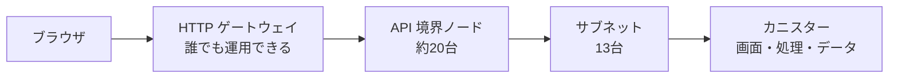

「ICP（Internet Computer）という web3 があって、クラウドとブロックチェーンを合体させたものらしい」。

私の最初の認識はこの程度でした。そこで、英語の公式ドキュメントと公開データを中心に調べてみました。この記事では、仕組み・応用例・現状を順に見ていき、普段 AWS を使っている人の目線でも説明します。最後に Ethereum・Solana とも比べます。

ブロックチェーンに詳しくない人でも読めるように、専門用語は出てきたところで説明します。

## この記事の書き方

この記事は**調べた結果のまとめ**です。

- 推測や印象で空白を埋めることはしません
- 数字には出典と取得日を付けます。調査日は **2026年11月17日**です。価格や網の規模は日々変わるので、その日の値として読んでください
- 報道や個人ブログなど、二次的な情報しか見つからなかったものは、その旨を書きます
- 私の意見は、最後の「見立て」の章にまとめます

### 読んだ資料

- **公式ドキュメント** [docs.internetcomputer.org](https://docs.internetcomputer.org/)：開発元の DFINITY 財団による開発者向けの資料です。仕組み・制限・料金はここから引きます
- **ホワイトペーパー** [The Internet Computer for Geeks](https://internetcomputer.org/whitepaper.pdf)（v1.4、2023年12月）：設計の原典です
- **料金表** [Cycle costs](https://docs.internetcomputer.org/references/cycle-costs/)：計算・保存・通信の単価が載っています
- **公式ダッシュボードの API** [ic-api.internetcomputer.org](https://ic-api.internetcomputer.org/)：[ダッシュボード](https://dashboard.internetcomputer.org/)の裏で動いている API です。ノード数やプログラム数はここから直接取りました
- **Mission 70 ホワイトペーパー** [mission70.pdf](https://internetcomputer.org/whitepapers/mission70.pdf)（2026年2月）：トークンの発行を減らす計画の文書です
- 比較対象の公式資料：[AWS の料金ページ](https://aws.amazon.com/lambda/pricing/)、[ethereum.org](https://ethereum.org/developers/docs/)、[solana.com/docs](https://solana.com/docs)
- 公開データ：[DefiLlama](https://defillama.com/chains)（ブロックチェーン上の金融サービスに預けられた金額）、[CoinGecko](https://www.coingecko.com/)（価格）、Ethereum と Solana の公開 RPC（検証者の数やブロックの間隔）

## まず3行で

1. ICP は、**世界中の独立した事業者が持ち寄ったサーバーで動く、ブロックチェーン製のクラウド**です
2. AWS のように、Web サイトの画面・処理・データをまとめて置けます。ただし運営しているのは1社ではなく、事業者たちを束ねる**投票の仕組み**です
3. 技術はユニークです。一方で利用はまだ小さく、トークンの価格は大きく下がっています

「クラウドとブロックチェーンの合体」という最初の認識は、ほぼ当たっていました。現在の[公式トップページ](https://internetcomputer.org/)は、自分たちを "Sovereign serverless cloud"（誰かに止められない、サーバーレスのクラウド）と紹介しています。ホワイトペーパーは「新しい設計のブロックチェーン」と書いています。どちらの顔も持っているわけです。

## 先に覚えておくと楽な言葉

| 言葉 | ひとことで | AWS でいうと |
|---|---|---|
| **カニスター** | ICP の上で動くプログラム。コードとデータがひとまとまりになっている | Lambda 関数とその保存領域をくっつけたもの |
| **サブネット** | 13台前後のサーバーの集まり。カニスターはどれかのサブネットに住む | リージョンに少し似ている |
| **サイクル** | カニスターを動かす燃料。先払いでチャージしておく | 前払いの利用料 |
| **ICP トークン** | ICP の暗号資産。燃やしてサイクルに変えたり、投票に使ったりする | 対応するものはない |
| **NNS** | ICP 全体の運営を決める投票の仕組み | Amazon という会社の意思決定 |

## ICP はどう動いているか

### カニスター：コードとデータが一緒に住んでいる

ICP 上のプログラムは**カニスター**と呼ばれます。[公式の説明](https://docs.internetcomputer.org/concepts/canisters/)では「コンパイル済みの WebAssembly と、その状態をひとまとめにしたもの」です。

ふつうの Web アプリでは、プログラムとデータベースは別物です。カニスターでは、**プログラムの変数に入れた値が、そのまま次の呼び出しまで残ります**。データベースに書き出す必要がありません。

どれくらい入るかは[制限の一覧](https://docs.internetcomputer.org/references/resource-limits/)に載っています。

| 項目 | 上限 |
|---|---|
| 普段使うメモリ | 4 GiB（64ビット版では 6 GiB） |
| 長期保存用のメモリ | カニスター1つあたり 500 GiB |
| サブネット全体の容量 | 2 TiB（そのサブネットのカニスター全員で分け合う） |

使える言語は、公式が支えている **Motoko**（DFINITY が作った専用の言語）と **Rust** が中心です。TypeScript 向けの Azle などは有志が保守しています（[言語の一覧](https://docs.internetcomputer.org/languages/)）。Python 向けの Kybra は、2025年5月から更新が止まっています（[GitHub](https://github.com/demergent-labs/kybra)）。

### サブネット：13台で同じ処理をして答え合わせする

Ethereum では、世界中の**すべて**のノードが**すべて**の取引を計算します。安全ですが、遅くて高くつきます。

ICP は、サーバーを**サブネット**という小さなグループに分けます。各サブネットは、自分のところに住んでいるカニスターだけを計算します。

- ふつうのアプリが住むサブネットは**13台**です。お金に関わる重要なものは34〜40台のサブネットに置かれます（[概要ページ](https://docs.internetcomputer.org/concepts/network-overview/)）
- 13台が同じ計算をして、結果が一致したものを正しいとします。何台かが故障したり不正をしたりしても、答えは変わりません
- 調査日時点では、**42 のサブネットに 618 台**が割り当てられていました。登録されているサーバーは全部で **1,278 台**、運用している事業者は **74**、データセンターは **99 か所**です（ダッシュボード API）

全員で計算しないから速くて安い。その代わり、1つのサブネットを支えているのは13台だけです。これが ICP の設計の基本的な割り切りです。

### 呼び出しは「読むだけ」と「書き換える」の2種類

[性能のページ](https://docs.internetcomputer.org/concepts/protocol/performance/)によると、カニスターの呼び出し方は2つあります。

- **読むだけ（クエリ）**：1台が答えます。**無料**で、100〜200ミリ秒ほどで返ってきます
- **書き換える（更新）**：13台で答え合わせをしてから書き換えます。確定まで**1〜2秒**です。いったん確定したら、あとで覆ることはありません

### ブラウザに直接ページを返せる

Ethereum や Solana のアプリは、画面の部分を AWS や Vercel などに置くのが普通です。ブロックチェーンには計算とお金の処理だけを任せます。

ICP では、**カニスターが HTML や JavaScript をそのままブラウザに返せます**（[配信の仕組み](https://docs.internetcomputer.org/concepts/edge-infrastructure/)）。

返ってくる応答にはサブネットの電子署名が付いていて、途中で書き換えられていないことを確かめられます。画面からデータまで一つの網の中で完結すること。これが「クラウドとの合体」と言われる理由です。

### 料金を払うのは、使う人ではなく作った人

Ethereum や Solana では、取引のたびに**使う人**が手数料（ガス代）を払います。そのため利用者は、暗号資産のウォレットを用意しなければなりません。

ICP では、**カニスターにチャージしてある「サイクル」から料金が引かれます**。公式はこれを「逆ガス方式」と呼んでいます。

- 1兆サイクル = 1 XDR に固定されています。XDR は国際通貨基金が使う通貨単位で、料金表は 1 XDR = 1.37 ドルほどで計算しています。**ICP トークンの価格が上下しても、サイクルの値段は変わりません**
- サイクルは ICP トークンを燃やして作ります
- [サイクルの説明](https://docs.internetcomputer.org/concepts/cycles/)には「利用者は、ほかの Web サービスと同じように無料でアプリを使える」とあります。**利用者はウォレットもトークンも要りません**

### 他のブロックチェーンのお金を、自分の鍵で動かせる

ICP には「**チェーンキー暗号**」という仕組みがあります。サブネットの13台が、鍵を少しずつ分けて持ちます。どの1台も鍵の全体は知りませんが、協力すれば署名を作れます。

これを使うと、**カニスターが自分の Bitcoin や Ethereum の口座を持ち、自分で署名して送金できます**。普通は「ブリッジ」と呼ばれる中継サービスに預けて橋渡ししてもらうところを、ICP は自分でやれます。公式はこれを [Chain Fusion](https://docs.internetcomputer.org/concepts/chain-fusion/) と呼んでいます。

この仕組みで作られたのが ckBTC や ckETH です。本物の BTC や ETH と 1:1 で裏付けられたトークンです（[解説](https://docs.internetcomputer.org/concepts/chain-fusion/chain-key-tokens/)）。

さらに、カニスターから**外部の Web API を直接呼べます**（[HTTPS アウトコール](https://docs.internetcomputer.org/concepts/https-outcalls/)）。サブネットの各サーバーが同じ API を呼び、3分の2以上の結果が一致したら採用します。Ethereum や Solana でこれをやるには、Chainlink のような外部サービスが必要です。

### 運営は投票で決まる

ICP 全体のアップデート、サブネットの新設、どの事業者を仲間に入れるか。こうしたことは **NNS** という仕組みで決まります（[統治の説明](https://docs.internetcomputer.org/concepts/governance/)）。

- ICP トークンを一定期間預けた人が投票できます
- 可決されると、アップデートは自動で全体に反映されます

個々のアプリも、**SNS** という仕組みで、運営を利用者の投票に任せることができます。

### AI まわり

- **LLM カニスター**：ICP の上で AI の推論を動かすサービスです。いま使えるモデルは Llama 3.1 8B だけで、出力は1000トークンまでです。料金は「最初の期間は無料」とされ、まだ決まっていません（[公式ガイド](https://docs.internetcomputer.org/guides/backends/ai-inference/)）
- **Caffeine**：話しかけるだけで AI がアプリを作り、ICP に置いてくれる DFINITY のサービスです。応用例の章で紹介します

## AWS を使っている人から見た ICP

ここでは、AWS で Web サービスを作っている人が ICP を見たらどう感じるかを、項目ごとに整理します。

### AWS のサービスに置き換えると

| AWS でやっていること | ICP ではこうなる |
|---|---|
| EC2・Lambda でサーバー処理を動かす | カニスターに処理を書く |
| S3 ＋ CloudFront で静的サイトを配信する | 「アセットカニスター」に画面のファイルを置く（[手順](https://docs.internetcomputer.org/guides/frontends/static-site/overview/)） |
| DynamoDB・RDS にデータを保存する | カニスターの変数やメモリにそのまま持つ |
| Cognito でログインを作る | Internet Identity を使う（パスキーや Google アカウントでログインできる） |
| EventBridge で定期実行する | カニスターのタイマー機能を使う（[タイマー](https://docs.internetcomputer.org/guides/backends/timers/)） |
| リージョンを選ぶ | サブネットを選ぶ（欧州のサーバーだけで作られたサブネットもある） |
| 月末に請求書が来る | サイクルを先にチャージしておき、使った分が減っていく |
| 障害時は AWS が対応する | 事業者たちと DFINITY が対応し、更新は投票で決まる |

### 料金の感覚

ICP の料金表と AWS の料金ページから、同じ条件で計算してみました。為替や前提によって変わるので、**桁の感覚をつかむための目安**として見てください。

**保存（1 GB を1か月置く）**

| | 1 GB・1か月 |
|---|---|
| AWS S3 Standard（[料金](https://aws.amazon.com/s3/pricing/)） | 約 0.023 ドル |
| ICP（13台のサブネット） | 約 0.45 ドル |

ICP は S3 の**約20倍**です。ただし S3 は1か所に保存するだけなのに対し、ICP は13台がそれぞれ同じデータを持っています。

**データを書き換える処理を100万回呼ぶ**

| | 100万回 | 前提 |
|---|---|---|
| AWS Lambda | 約 0.41 ドル | メモリ 128 MB、1回 0.1 秒。リクエスト料 0.20 ドル＋計算料 0.21 ドル（無料枠は使わない計算） |
| ICP の更新呼び出し | 約 25 ドル | 1回あたり 1 KB を送り、1,000万命令を実行。受信料・基本料・実行料を[料金表](https://docs.internetcomputer.org/references/cycle-costs/)から合計 |

書き換える処理は、Lambda より**数十倍高く**なります。一方で、**読むだけの呼び出しは ICP では無料**です。読む回数が多いサービスなら、差は縮まります。

### AWS に慣れていると戸惑うところ

公式ドキュメントで確認できた注意点です。

- **データは「改ざんされない」けれど「秘密」ではない**：[セキュリティの指針](https://docs.internetcomputer.org/guides/security/data-storage/)には「カニスターは完全性を守るが、機密性は守らない。カニスターのデータはノードが読める」とあります。ノードを運用している事業者は、保存されたデータを読めます。秘密にしたいデータは、vetKeys という仕組みで暗号化する必要があります。公式は、将来は TEE（サーバー内の暗号化された領域）で事業者からも見えなくすると書いています（[注意事項](https://docs.internetcomputer.org/guides/security/miscellaneous/)）
- **サイクルが切れるとデータごと消える**：[サイクルの説明](https://docs.internetcomputer.org/concepts/cycles/)によると、サイクルが切れたカニスターは止まります。そのあと猶予期間（初期設定では、何もしなくても減っていく分の30日相当）のうちにチャージしないと、**データもろとも削除され、元に戻せません**。AWS の「支払いが遅れたら止まる」より厳しいので、残高の監視は必須です
- **SQL のデータベースがない**：RDS のような管理されたデータベースは用意されていません。データ構造は自分でコードとして書きます
- **1回の処理に上限がある**：1回の更新で使えるのは 400億命令まで、送れるデータは 2 MiB までです（[制限の一覧](https://docs.internetcomputer.org/references/resource-limits/)）。重いバッチ処理は分割する必要があります
- **Docker やいつもの言語がそのまま使えない**：書くのは WebAssembly に変換できる言語で、中心は Motoko と Rust です
- **アップデートに失敗すると取り返しがつかないことがある**：公式は「更新の手順をテストしておかないと、カニスターが更新できなくなる」と注意し、作り直せる復旧手順を用意するよう勧めています（[セキュリティの指針](https://docs.internetcomputer.org/guides/security/data-storage/)）

### 逆に、AWS では手間がかかることが簡単にできる

- **利用者にブロックチェーンを意識させない**：ウォレットも手数料も要りません。ログインもパスキーで済みます
- **「運営が勝手にデータを書き換えていない」ことを示せる**：応答に署名が付き、カニスターのコードの指紋（ハッシュ）も公開されます
- **Bitcoin や Ethereum を直接扱える**：自前で秘密鍵を管理するサーバーを立てる必要がありません
- **自分で止められないサービスを作れる**：運営を SNS の投票に渡せば、作った本人でも勝手に止められなくなります

## Ethereum・Solana と比べると

### 性質の比較

| | ICP | AWS | Ethereum | Solana |
|---|---|---|---|---|
| 運営しているのは | 74 の独立した事業者（NNS の投票で統治） | Amazon 1社 | 誰でも検証者になれる | 誰でも検証者になれる |
| 同じ計算を何台でするか | サブネットの13〜40台 | 1台（冗長化は自分で設計） | 全員（検証者は約79万） | 全員（検証者は約700） |
| 料金を払うのは | **作った人** | 作った人 | 使う人 | 使う人 |
| 利用者にウォレットは必要か | 不要 | 不要 | 原則必要 | 原則必要 |
| 画面を直接配信できるか | **できる** | できる | できない | できない |
| 書き込みが確定するまで | 1〜2秒 | 一瞬 | 約13分以上 | 約0.15秒（目標値） |
| 外部の Web API を呼べるか | 呼べる | 呼べる | 外部サービスが必要 | 外部サービスが必要 |

出典と補足：

- Ethereum の検証者数は、公開 API で稼働中の検証者を数えた値（786,052）です。確定時間は仕様（12秒 × 32 × 2）からの計算値で、取得時の実測では約16分遅れでした（[ethereum.org](https://ethereum.org/developers/docs/consensus-mechanisms/pos/)）
- Solana の検証者数は、公開 RPC で数えた投票アカウントの数（699）です。2026年10月21日に新しい合意の仕組み Alpenglow が本番で有効になり、確定時間の目標が約150ミリ秒になりました（[solana.com](https://solana.com/upgrades/alpenglow)、[Cointelegraph](https://cointelegraph.com/news/solanas-alpenglow-launches-mainnet-99-faster-finality)）
- Ethereum や Solana でも、追加の仕組みを使えば利用者の手数料をアプリ側で肩代わりできます

### 1 GB を保存するといくらか

いちばん差が出るのは保存の費用です。価格は 2026年11月17日の CoinGecko の値（ETH 1,815.94 ドル、SOL 71.64 ドル）で計算しました。

| | 1 GB あたり | 払い方 |
|---|---|---|
| AWS S3 | 約 0.023 ドル | 毎月 |
| ICP | 約 0.45 ドル | 毎月 |
| Solana | 約 36 万ドル | 1回だけ預ける（使わなくなったら戻る） |
| Ethereum | 約 16 万ドル | 1回だけ払う（戻らない） |

- Solana は公開 RPC で、1 MB に必要な預け金（約 5.08 SOL）を確かめました。2026年9月から段階的に値下げされていて、最終的には約7分の1になる予定です（[SIMD-0437](https://solana.com/upgrades/reduced-rent)）
- Ethereum は 32 バイトごとに 20,000 ガス（[evm.codes](https://www.evm.codes/#55)）を、取得時のガス代 0.138 gwei で計算しました。ガス代が 1 gwei なら約 113 万ドルになります

ICP の保存は、Ethereum や Solana より**数十万倍安い**のです。ブロックチェーンの上に大きなデータを置けるのは、比べた中では ICP だけでした。

### 規模の比較

| | 預けられた金額（DefiLlama） | 時価総額（CoinGecko） | 開発者の数（Electric Capital） |
|---|---|---|---|
| Ethereum | 375.8億ドル | 2,220億ドル | 31,869人（2025年9月） |
| Solana | 47.5億ドル | 424億ドル | 17,708人（2025年9月） |
| ICP | **780万ドル** | 13.8億ドル | 約2,970人（2024年の報告） |

「預けられた金額」は、そのブロックチェーン上の金融サービスに預けられている資産の合計です。開発者の数は Electric Capital の報告を報道経由で確認したもので（[Cointelegraph](https://cointelegraph.com/news/ethereum-attracted-16k-new-developers-9-months)、[developerreport.com](https://developerreport.com/)）、ICP だけ年が違うので参考値です。

ICP の預けられた金額は、Ethereum の約5,000分の1です。ただ、ICP は金融を主な用途にしていないので、この数字だけでは全体の大きさは測れません。

## どんなことに使われているか

### いま動いているもの

- **Caffeine**（DFINITY）：「こんなアプリがほしい」と話しかけると、AI がアプリを書いて ICP に置き、あとから直すところまでやってくれます。AI の修正がデータを壊しそうなときは、反映を止める仕組みがあると[公式は説明](https://internetcomputer.org/ecosystem-spotlight/caffeine)しています。2025年7月15日に早期利用が始まり（[BusinessWire](https://www.businesswire.com/news/home/20250715119613/en)）、2025年10月に一般公開と報じられました（[VentureBeat](https://venturebeat.com/ai/dfinity-launches-caffeine-an-ai-platform-that-builds-production-apps-from)）。いま DFINITY がいちばん力を入れている製品です。利用者数は、早期利用の時点の「1万5000人超」（VentureBeat）より新しく、第三者が確かめた数字は見つかりませんでした
- **OpenChat**：ICP の上で動くチャットアプリです。SNS で運営を利用者の投票に任せていて、そのときの売り出しで550万ドルを集めました（[The Block](https://www.theblock.co/amp/post/217854/openchat-to-transfer-control-to-community-after-5-5-million-decentralization-sale)、2023年）。調査日にもサイトは動いていました
- **Internet Identity**：パスキーや Google・Apple・Microsoft のアカウントでログインできる仕組みです。アプリごとに別の ID を作るので、アプリをまたいで利用者を追いかけられません（[ガイド](https://docs.internetcomputer.org/guides/authentication/internet-identity/)）
- **ckBTC と金融サービス**：ckBTC の発行量は約227.5 BTC です（ダッシュボード API）。DefiLlama によると、主なサービスは WaterNeuron（約590万ドル）、Liquidium（約430万ドル）、交換所の ICPSwap（約320万ドル）です

### 国や国際機関との取り組み（まだ試験の段階）

- **パキスタン**：2026年2月10日、パキスタン・デジタル庁と覚書を結びました。国専用のサブネット、国のメッセンジャーアプリの試験、Caffeine の利用権1,500件などが入っています（[公式発表](https://www.internetcomputer.org/news/media-releases/pakistan-digital-authority-dfinity-partnership-announcement)）
- **国連開発計画（UNDP）**：2026年8月25日、AI とクラウドの1年間の試験事業が発表されました。費用や使いやすさを評価し、各国の政府が広げたいと思うかを見るそうです（[Axios](https://axios.com/2026/08/25/un-sovereign-ai-big-tech-cloud)）
- **Cloud Engines**：企業や国が、自分専用のサブネットを借りられる仕組みです。2026年1月のダボス会議でスイス向けが紹介され（[tech.eu](https://tech.eu/2026/07/27/beyond-the-hyperscale-cloud-dfinity-s-vision-for-sovereign-computing/)）、2026年11月に商用提供が始まったと報じられています。お金を払っている利用者の数は、ほとんど公表されていません（[cryptonews.net](https://cryptonews.net/news/altcoins/33730221/)）

どれも、本番で収益が出ているところまでは確認できませんでした。

### 止まったもの・なくなったもの

- **DSCVR**（ICP 生まれの SNS）：2023年に Solana にも進出しました。調査日にアクセスすると「このサービスは停止されています」と表示されました
- **KongSwap**（交換所）：2026年4月6日に閉鎖しました。理由は「製品が市場に合わなかった」ことだそうです（[運営者側の振り返り記事](https://dev.to/sssdefi/what-we-learned-from-kongswap-product-governance-trust-and-exit-design-in-defi-1g25)、二次情報）
- 2021〜22年に盛り上がった NFT は、今の活動を確認できませんでした

## 今の ICP を数字で見る

2026年11月17日に、ダッシュボード API・DefiLlama・CoinGecko から取った値です。

| 指標 | 値 | これまでの動き |
|---|---|---|
| 動いているカニスター | 117万3,700 | 2024年1月は37万、2025年1月は88万、2026年1月は100万 |
| 止まっているカニスター | 10万6,379 | 2026年1月は3万4,500 |
| 燃やされたサイクル（30日平均） | 毎秒 約0.055 XDR | 2026年1月の平均は約0.047 XDR |
| 保存されているデータの合計 | 約12.6 TB | — |
| 預けられた金額 | 780万ドル | いちばん多かったのは2024年1月の約1億190万ドル |
| ICP の価格 | 2.47 ドル | 上場した日（2021年5月10日）の 700.65 ドルから約99.6%下落。2026年8月1日に過去最安の 2.00 ドル |

カニスターの数は増え続けています。一方で、実際にどれだけ使われたかを表す「燃やされたサイクル」は、ほとんど増えていません。

### Mission 70：トークンの増えすぎを7割抑える計画

ICP トークンは、投票した人やサーバーの事業者へのご褒美として、新しく発行され続けています。2026年初めには、1年で 9.72% 増えるペースでした。

[Mission 70](https://internetcomputer.org/whitepapers/mission70.pdf) は、このペースを2026年末までに7割下げる計画です（[フォーラムの告知](https://forum.dfinity.org/t/mission-70-is-now-here/62587)）。

- **約44ポイントは、発行を減らして達成します**：ご褒美を減らし、トークンを預けられる最長期間を8年から2年に縮めます。関係する提案（140538、141328）が可決・実行されたことは、ダッシュボードで確認しました
- **残りの約26ポイントは、ICP がもっと使われることが前提です**：使われてサイクルが燃えれば、そのぶんトークンが減ります。目標は毎秒 0.77 XDR 分ですが、調査日時点は 0.055 XDR で、目標の約14分の1です

Cloud Engines の売上は、8割がサーバーの事業者に、2割が ICP の買い戻しと焼却に回る設計だと報じられています（[coinpaprika](https://coinpaprika.com/news/internet-computer-icp-cuts-inflation-80-20-cloud-engine-model/)）。残りの26ポイントが達成できるかは、この事業が伸びるかどうか次第です。

### 最近の障害

公式フォーラムに事後報告があるものです。

- **2025年12月3日**：利用者の通信を受け付ける API 境界ノードの更新に失敗し、**20台すべて**が28分間止まりました。ICP 本体は動いていましたが、Internet Identity や OpenChat に利用者がつながりませんでした（[事後報告](https://forum.dfinity.org/t/post-mortem-faulty-api-bn-upgrade-on-december-3-2025/61213)）
- **2026年3月5日**：欧州のサブネットで、更新後に約30分間、処理が遅れました（[フォーラム](https://forum.dfinity.org/t/european-subnet-experiencing-timeouts-on-update-messages/65121)）
- **2026年8月3日**：一部の境界ノードで TLS 証明書の期限が切れ、地域によって約24分つながりませんでした。その間、状態ページは「正常」のままでした（[フォーラム](https://forum.dfinity.org/t/ic0-app-and-icp0-app-expired/74904)）

## 指摘されている弱点

- **投票の力が偏っている**：2024年9月末の時点で、DFINITY と関連団体が投票権の約19.7%を持っていました（[DFINITY の Medium](https://medium.com/dfinity/the-community-led-governance-of-the-internet-computer-b863cd2975ba)）。多くの投票者は「DFINITY と同じ票を入れる」設定にしているので、実際の影響力はもっと大きいと長く批判されています。2026年の数字は見つかりませんでした
- **入口が少ない**：利用者の通信は約20台の API 境界ノードを通ります。上の障害のように、ここが止まると ICP 全体が止まって見えます
- **1つのサブネットは13台**：全員で計算する Ethereum とは、安全性の考え方が違います
- **利用がまだ小さい**：預けられた金額は Ethereum の約5,000分の1です。かつての看板アプリにも、止まったり閉鎖したりしたものがあります
- **トークンの過去**：上場から約1か月で価格が約9割下がりました。調査会社 Arkham Intelligence は、関係者とみられる口座から取引所へ約20億ドル分が移ったと報告しています。2021年8月に集団訴訟が起こされましたが、2025年3月に「時効」を理由に却下されました。訴えの中身は判断されていません（[Decrypt](https://decrypt.co/311842/california-judge-dismisses-dfinity-investor-suit-being-time-barred)）
- **覚えることが多い**：カニスター、サイクル、Motoko、逆ガス方式と、ほかのクラウドにもブロックチェーンにもない考え方が多くあります。ICP 本体の開発も、ほとんどを DFINITY が担っています

## 見立て（ここからは私の意見です）

ここまでの事実をもとにした、私の解釈です。

**「クラウドとブロックチェーンの合体」という理解は正しい。ただ、どちらの世界でもまだ小さい。** 画面の配信、処理、大きなデータの保存、外部 API の呼び出し、他のブロックチェーンでの署名。これらを一つの網で完結できるのは、比べた中では ICP だけでした。技術のユニークさは本物です。

でもクラウドとして見ると、AWS より保存は約20倍、書き込みは数十倍高く、データは事業者から見えます。ブロックチェーンとして見ると、お金も開発者も Ethereum や Solana に大きく差をつけられています。

**向いているのは「運営者を信じなくていいこと」にお金を払う場面だと思います。** 例えば次のようなアプリです。

- 特定の企業や国に止められたくないアプリ
- データが書き換えられていないことを、第三者に示したいアプリ
- 利用者にウォレットを持たせずに、ブロックチェーンの性質を使いたいアプリ
- Bitcoin を直接扱うアプリ

ただ安く速く Web サービスを動かしたいだけなら、AWS のほうが合理的です。

**DFINITY は「AI がアプリを作る時代の置き場所」に賭けているように見えます。** Caffeine、Cloud Engines、各国との試験事業は、どれもその方向を向いています。AI が書いたコードを、データを壊さずに更新できる場所にそのまま置く、という筋は通っています。ただ、トークンの仕組みが安定するには、燃やされるサイクルが今の約14倍まで増える必要があります。調査日の時点では、その兆しはまだ数字に出ていません。

これから見ておきたいのは、カニスターの数よりも**燃やされたサイクルの量**と、**Cloud Engines にお金を払っている利用者の数**です。どちらもダッシュボードや公式発表で追えるので、半年後にもう一度確かめてみるつもりです。
