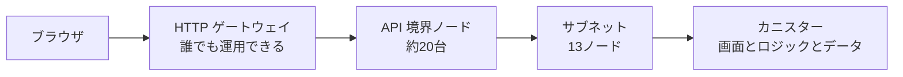

「ICP（Internet Computer）という web3 があって、クラウドとブロックチェーンを合体させたものらしい」。この程度の認識しかなかったので、調べてみました。英語の公式ドキュメントと公開データを中心に、仕組み・応用例・現状を確認し、AWS・Ethereum・Solana と比べています。

この記事は**調べた結果のまとめ**です。推測や印象で埋めず、数字にはすべて出典と取得日を付けます。筆者の意見は最後の「見立て」の章に分けて書きます。

## 読んだ一次資料

調査日は **2026年11月17日**です。数字はこの日に取得したもので、価格や網の規模は日々変わります。

- **公式ドキュメント** [docs.internetcomputer.org](https://docs.internetcomputer.org/)：開発元の DFINITY 財団が運営する開発者向け資料です。仕組み・制限値・料金表はここから引きます。旧 `internetcomputer.org/docs/...` の URL は現在このサイトへ転送されます
- **ホワイトペーパー** [The Internet Computer for Geeks](https://internetcomputer.org/whitepaper.pdf)（v1.4、2023年12月）：プロトコル設計の原典です
- **料金表** [Cycle costs](https://docs.internetcomputer.org/references/cycle-costs/)：計算・保存・通信の単価が載っています
- **公式ダッシュボードの API** [ic-api.internetcomputer.org](https://ic-api.internetcomputer.org/)：[dashboard.internetcomputer.org](https://dashboard.internetcomputer.org/) の裏で動いている API です。ノード数やカニスター数はここから直接取りました
- **Mission 70 ホワイトペーパー** [mission70.pdf](https://internetcomputer.org/whitepapers/mission70.pdf)（2026年2月）：トークンの発行量を減らす計画の文書です
- 比較対象の公式資料：[ethereum.org](https://ethereum.org/developers/docs/)、[solana.com/docs](https://solana.com/docs)、[AWS の料金ページ](https://aws.amazon.com/s3/pricing/)
- 比較用の公開データ：[DefiLlama](https://defillama.com/chains)（預かり資産額）、[CoinGecko](https://www.coingecko.com/)（価格）、Ethereum と Solana の公開 RPC（検証者数・ブロック時間）

報道や個人ブログなど二次的な情報しか見つからなかったものは、その旨を明記しています。

## 一言でいうと

最初の認識「クラウドとブロックチェーンの合体」は、公式の自己紹介とほぼ一致します。ただし公式は、時期によって強調する面を変えています。

- ホワイトペーパーは「スマートコントラクトの可能性を解き放つ、新しい設計のブロックチェーン」と書いています
- 現在の[公式トップページ](https://internetcomputer.org/)は "Sovereign serverless cloud"（主権を持てるサーバーレスクラウド）と名乗り、AI が作るアプリの置き場所を前面に出しています
- 開発者向けの[概要ページ](https://docs.internetcomputer.org/concepts/network-overview/)は「**サブネット**と呼ばれる独立したブロックチェーンの集まりで、**カニスター**を Web の速度で動かす網」と定義しています

かつてよく使われた "World Computer"（世界コンピュータ）という言い方は、現在の公式トップページとドキュメントには見当たりませんでした。売り出し方は「ブロックチェーン」から「クラウド」へ寄っています。

## 仕組み

### カニスター：プログラムと保存領域がひとまとまりになったもの

Internet Computer 上のプログラムは**カニスター**と呼ばれます。[公式の説明](https://docs.internetcomputer.org/concepts/canisters/)では「コンパイル済みの WebAssembly と、その永続的な状態を一つにまとめた単位」です。

Ethereum のスマートコントラクトと違うのは、**メモリをそのまま保存領域として持てる**点です。変数に入れた値が、データベースに書き出さなくても次の呼び出しまで残ります。[制限値の一覧](https://docs.internetcomputer.org/references/resource-limits/)によると、容量は次のとおりです。

| 項目 | 上限 |
|---|---|
| ヒープ（通常のメモリ） | 4 GiB（wasm32）／ 6 GiB（wasm64） |
| 安定メモリ（更新をまたいで残す領域） | カニスター1つあたり 500 GiB |
| サブネット全体の容量 | 2 TiB（そのサブネット上の全カニスターで共有） |
| 1回の更新呼び出しで使える命令数 | 400億命令 |
| 1回の問い合わせで使える命令数 | 50億命令 |

書く言語は、公式が支えているのが **Motoko**（DFINITY が作った専用言語）と **Rust** です。TypeScript 向けの Azle などは有志が保守しています（[言語の一覧](https://docs.internetcomputer.org/languages/)）。Python 向けの Kybra は、最後の更新が 2025年5月で止まっています（[GitHub](https://github.com/demergent-labs/kybra)）。

### サブネット：13台程度のノードで1本のチェーンを動かす

Ethereum では、すべてのノードがすべての取引を実行します。Internet Computer は網を**サブネット**に分け、それぞれのサブネットが自分に載っているカニスターだけを実行します。

- [概要ページ](https://docs.internetcomputer.org/concepts/network-overview/)によると、サブネットは13〜40ノードで、普通のアプリは13ノードのサブネットに載ります
- ダッシュボード API で数えると、**42 サブネット**に **618 ノード**が割り当てられていました。登録されているノードは全部で **1,278台**です（未割り当てが640台、利用者の通信を中継する専用ノードが20台）
- ノードは独立した事業者（**74 事業者、99 データセンター**）が専用ハードウェアで運用します。どの事業者を網に入れるかは、後述の統治の仕組みで投票して決めます

13台で合意を取るので、全ノードで実行する方式より速く安く動きます。その代わり、1つのサブネットを支える台数は少なくなります。これがこの設計の基本的な取引です。

### 2種類の呼び出し：問い合わせと更新

[性能のページ](https://docs.internetcomputer.org/concepts/protocol/performance/)によると、呼び出しは2種類あります。

- **問い合わせ（クエリ）**：1台のノードが答える読み取り専用の呼び出しです。無料で、応答は 100〜200 ミリ秒程度です
- **更新**：サブネットで合意を取ってから状態を書き換えます。確定まで **1〜2秒**で、確率的ではなく暗号的に確定します。2025年7月の実測の中央値は 1.75 秒です

### ブラウザに直接ページを返せる

Ethereum や Solana のアプリは、画面部分を AWS や Vercel、IPFS などに置くのが普通です。Internet Computer では、**カニスターが HTML や JavaScript をブラウザに直接返せます**（[配信の仕組み](https://docs.internetcomputer.org/concepts/edge-infrastructure/)）。

返ってくる応答にはサブネットの署名が付き、ゲートウェイがそれを検証します。画面の配信からデータの保存まで、一つの網の中で完結するのが「クラウドと合体」と言われる理由です。

### 逆ガス方式：料金を払うのは利用者ではなく開発者

Ethereum や Solana では、取引のたびに**利用者**が手数料（ガス）を払います。Internet Computer では、カニスターが持っている「**サイクル**」から料金が引かれます。公式は、これを「逆ガス方式」と呼んでいます。

- **1兆サイクル = 1 XDR**（国際通貨基金の特別引出権。料金表は 1 XDR = 1.366430 米ドルで換算）に固定されています。ICP トークンの値動きに関係なく、開発者から見た単価は一定です
- サイクルは ICP トークンを燃やして作ります
- [サイクルの説明](https://docs.internetcomputer.org/concepts/cycles/)には「利用者はほかの Web サービスと同じように無料でアプリを使える」とあります。利用者は暗号資産のウォレットもトークンも持たなくてよいわけです

[料金表](https://docs.internetcomputer.org/references/cycle-costs/)から主なものを抜き出します（13ノードのサブネットの場合。34ノードのサブネットでは約2.6倍）。

| 項目 | サイクル | 米ドル換算 |
|---|---|---|
| 問い合わせ | 無料 | 無料 |
| カニスターの作成 | 5,000億 | 約 0.68 ドル |
| 10億命令の実行 | 10億 | 約 0.0014 ドル |
| 保存 1 GiB・1か月 | 約 3,290億 | **約 0.45 ドル** |
| 他チェーン向けの署名1回 | 約 261.5億 | 約 0.036 ドル |

### Chain Fusion：橋渡しなしで他のチェーンを操作する

Internet Computer の技術的な特色の一つが「**チェーンキー暗号**」です。サブネットのノードが鍵を分割して持ち、どのノードも鍵の全体を知らないまま、協力して署名を作ります（しきい値署名）。

これにより、カニスターが**自分の Bitcoin アドレスや Ethereum アドレスを持ち、自分で署名して送金できます**。公式はこの仕組みを [Chain Fusion](https://docs.internetcomputer.org/concepts/chain-fusion/) と呼び、「ブリッジもオラクルも要らない」と書いています。

- Bitcoin と Dogecoin とは、プロトコルの水準で直接つながっています
- Ethereum や Solana とは、複数の RPC 事業者に問い合わせて結果を突き合わせる専用カニスターを経由します
- これを使ったトークンが ckBTC・ckETH・ckUSDC などです。元の資産と 1:1 で裏付けられています（[解説](https://docs.internetcomputer.org/concepts/chain-fusion/chain-key-tokens/)）

外部の Web API も、カニスターから直接呼べます（[HTTPS アウトコール](https://docs.internetcomputer.org/concepts/https-outcalls/)）。サブネットの各ノードが同じ API を呼び、3分の2以上の結果が一致したら採用します。Ethereum や Solana で同じことをするには、Chainlink のような外部のオラクルが必要です。

### 統治：NNS という自律分散組織が網そのものを更新する

プロトコルの更新、サブネットの新設、ノード事業者の受け入れは、**NNS**（Network Nervous System）という自律分散組織（DAO）への提案と投票で決まり、可決されると自動で実行されます（[統治の説明](https://docs.internetcomputer.org/concepts/governance/)）。投票するには ICP トークンを一定期間預ける必要があります。公式は「ハードフォークが要らない」と説明しています。

個々のアプリも、**SNS** という仕組みで自前の自律分散組織を作り、運営を利用者に引き渡せます。

### AI 関連

- **LLM カニスター**：網の上で推論すると説明されています。現時点で使えるモデルは Llama 3.1 8B のみで、出力は1000トークンまでです。料金は「初期の展開期間は無料」とされ、未定です（[公式ガイド](https://docs.internetcomputer.org/guides/backends/ai-inference/)）
- **Caffeine**：話しかけるとアプリを作って Internet Computer に配置する、DFINITY のサービスです。詳しくは応用例で触れます

## AWS・Ethereum・Solana との比較

### 性質の比較

| | Internet Computer | AWS | Ethereum | Solana |
|---|---|---|---|---|
| 実行の単位 | カニスター（WebAssembly とメモリ） | 仮想マシン、Lambda 関数 | EVM のスマートコントラクト | プログラム（データは別の口座に置く） |
| 運営者 | 74 の独立事業者、NNS の投票で統治 | Amazon 1社 | 誰でも検証者になれる | 誰でも検証者になれる |
| 同じ処理を何台で実行するか | サブネットの13〜40台 | 1台（冗長化は自前で設計） | 全ノード（検証者は約79万） | 全ノード（検証者は約700） |
| 料金を払う人 | **開発者**（サイクル） | 開発者（請求書） | 利用者（ガス） | 利用者（手数料） |
| 利用者にウォレットが必要か | 不要 | 不要 | 原則必要 | 原則必要 |
| 画面を直接配信できるか | **できる** | できる | できない（別に置く） | できない（別に置く） |
| 確定までの時間 | 1〜2秒 | ミリ秒単位 | 約12.8分以上 | 約0.15秒（目標） |
| 外部 API の呼び出し | 標準機能 | 標準機能 | 外部のオラクルが必要 | 外部のオラクルが必要 |
| 他チェーンの資産を扱う | 自分で署名できる | 自前で鍵を管理 | ブリッジ経由 | ブリッジ経由 |

出典と補足：

- Ethereum の検証者数は、公開のビーコン API で稼働中の検証者を数えた値（786,052）です。確定時間は「2エポック（1エポック = 12秒 × 32スロット）」からの計算値で、取得時の実測では最新ブロックより約16分遅れていました（[ethereum.org](https://ethereum.org/developers/docs/consensus-mechanisms/pos/)）
- Solana の検証者数は、公開 RPC の `getVoteAccounts` で得た投票アカウント数（699）です。2026年10月21日に新しい合意方式 Alpenglow が本番で有効になり、確定時間の目標は約150ミリ秒になりました（[solana.com](https://solana.com/upgrades/alpenglow)、[Cointelegraph](https://cointelegraph.com/news/solanas-alpenglow-launches-mainnet-99-faster-finality)）。取得時の実測では、1スロットは約0.21秒でした
- Ethereum の ERC-4337 や Solana の手数料肩代わりを使えば、利用者に手数料を見せない作りもできます。ただし追加の仕組みが要ります

### 1 GB を保存するといくらか

いちばん差が出るのが保存の費用です。前提をそろえるのが難しいので、計算の仕方ごと示します。価格は 2026年11月17日の CoinGecko の値（ETH 1,815.94 ドル、SOL 71.64 ドル）です。

| | 費用 | 払い方 | 計算の根拠 |
|---|---|---|---|
| AWS S3 Standard | **約 0.023 ドル／GB・月** | 毎月 | [S3 料金](https://aws.amazon.com/s3/pricing/)（バージニア北部、最初の 50 TB） |
| Internet Computer（13ノード） | **約 0.45 ドル／GiB・月** | 毎月（サイクルから引かれる） | [料金表](https://docs.internetcomputer.org/references/cycle-costs/)の 127,000 サイクル／GiB・秒から計算 |
| Solana | **約 36 万ドル／GB** | 1回だけ預ける（口座を閉じれば戻る） | 公開 RPC の `getMinimumBalanceForRentExemption` で 1 MB あたり約 5.08 SOL |
| Ethereum | **約 16 万ドル／GB**（ガス代 0.138 gwei の場合） | 1回だけ（戻らない） | 32 バイトごとに 20,000 ガス（[evm.codes](https://www.evm.codes/#55)）。ガス代 1 gwei なら約 113 万ドル |

払い方が違うので単純には比べられませんが、桁の違いははっきりしています。

- Internet Computer の保存は、AWS S3 の**約20倍高い**です。ただし S3 は1か所に保存するだけなのに対し、Internet Computer は13台のノードがそれぞれ同じデータを持っています
- Ethereum や Solana と比べると、**数十万倍から数百万倍安く**なります。ブロックチェーン上に大きなデータを置くという選択肢は、事実上 Internet Computer にしかありません
- Ethereum の1ブロックに新しく書ける容量は約 96 KB です。1 GB を書くには、ブロックを丸ごと使い続けても1日半ほどかかります
- Solana の保存料は 2026年9月から段階的に引き下げられており（[SIMD-0437](https://solana.com/upgrades/reduced-rent)）、最終的には上の表の約7分の1になる予定です

### 生態系の規模

| | 預かり資産額（DefiLlama） | 時価総額（CoinGecko） | 開発者数（Electric Capital） |
|---|---|---|---|
| Ethereum | 375.8億ドル | 2,220億ドル | 31,869人（2025年9月） |
| Solana | 47.5億ドル | 424億ドル | 17,708人（2025年9月） |
| Internet Computer | **0.078億ドル（780万ドル）** | 13.8億ドル | 約2,970人（2024年報告） |

預かり資産額と時価総額は 2026年11月17日の値です。開発者数は Electric Capital の報告を報道経由で確認したもので（[Cointelegraph](https://cointelegraph.com/news/ethereum-attracted-16k-new-developers-9-months)、[developerreport.com](https://developerreport.com/)）、Internet Computer は年が違うので参考値です。

Internet Computer の預かり資産額は、Ethereum のおよそ5,000分の1です。ただし Internet Computer は金融（DeFi）を主な用途にしていないので、この指標だけで全体の規模は測れません。

## 応用例

### いま動いているもの

- **Caffeine**（DFINITY）：自然な言葉で頼むと、AI がフルスタックのアプリを書き、Internet Computer に配置し、更新まで行います。AI が提案した更新がデータを壊しうる場合は、Motoko の仕組みが反映を止めると[公式は説明](https://internetcomputer.org/ecosystem-spotlight/caffeine)しています。2025年7月15日に早期利用が始まり（[BusinessWire](https://www.businesswire.com/news/home/20250715119613/en)）、2025年10月に一般公開と報じられました（[VentureBeat](https://venturebeat.com/ai/dfinity-launches-caffeine-an-ai-platform-that-builds-production-apps-from)）。いま DFINITY がもっとも力を入れている製品です。ただし利用者数は、早期利用の段階の「1万5000人超」（VentureBeat）以降、第三者が確かめた数字が見つかりませんでした
- **OpenChat**：Internet Computer 上で動くチャットです。SNS で運営を利用者に移し、その際の売り出しで550万ドルを集めました（[The Block](https://www.theblock.co/amp/post/217854/openchat-to-transfer-control-to-community-after-5-5-million-decentralization-sale)、2023年）。サイトは調査日時点で動いています
- **Internet Identity**：パスキーや Google・Apple・Microsoft のアカウントでログインできる認証基盤です。アプリごとに別の利用者 ID を作るので、アプリをまたいだ追跡ができません（[ガイド](https://docs.internetcomputer.org/guides/authentication/internet-identity/)）
- **ckBTC と DeFi**：ckBTC の発行量は約227.5 BTC（ダッシュボード API）です。DefiLlama 上の主な事業は、ステーキングの WaterNeuron（約590万ドル）、Liquidium（約430万ドル）、交換所の ICPSwap（約320万ドル）です

### 政府・公的機関との取り組み（試験導入と覚書の段階）

- **パキスタン**：2026年2月10日、パキスタン・デジタル庁と覚書を結びました。国専用のサブネット、国営メッセンジャーの試験導入、Caffeine の利用権1,500件などが含まれます（[公式発表](https://www.internetcomputer.org/news/media-releases/pakistan-digital-authority-dfinity-partnership-announcement)）
- **国連開発計画（UNDP）**：2026年8月25日、主権を持てる AI とクラウドの1年間の試験事業が発表されました。費用や使い勝手を評価し、各国政府が拡大を望むかを見るとされています（[Axios](https://axios.com/2026/08/25/un-sovereign-ai-big-tech-cloud)）
- **Cloud Engines**：企業や国が自分専用のサブネットを借りる仕組みです。2026年1月のダボス会議でスイス向けが紹介され（[tech.eu](https://tech.eu/2026/07/27/beyond-the-hyperscale-cloud-dfinity-s-vision-for-sovereign-computing/)）、2026年11月に商用提供が始まったと報じられています。ただし、有料の利用者数はほとんど公表されていません（[cryptonews.net](https://cryptonews.net/news/altcoins/33730221/)）

どれも本番で収益が出ていることは確認できず、評価はこれからです。

### 消えた・止まったもの

- **DSCVR**（Internet Computer 発のソーシャルメディア）：2023年に Solana へ広げたあと、調査日時点ではサイトが「このサービスは停止されています」を返しました
- **KongSwap**（交換所）：2026年4月6日に閉鎖しました。理由は「製品と市場が合わなかった」ことです（[運営者の振り返り記事](https://dev.to/sssdefi/what-we-learned-from-kongswap-product-governance-trust-and-exit-design-in-defi-1g25)、二次情報）
- 2021〜22年に盛り上がった NFT 関連は、現在の活動を確認できませんでした

## 現状を数字で見る

ダッシュボード API と DefiLlama、CoinGecko から、2026年11月17日に取得した値です。

| 指標 | 値 | 推移 |
|---|---|---|
| 稼働中のカニスター | 117万3,700 | 2024年1月は37万、2025年1月は88万、2026年1月は100万 |
| 停止中のカニスター | 10万6,379 | 2026年1月は3万4,500 |
| サイクルの消費量（30日平均） | 毎秒 約0.055 XDR | 2026年1月の平均は約0.047 XDR |
| 保存データの総量 | 約12.6 TB | — |
| 預かり資産額 | 780万ドル | 2024年1月のピークは約1億190万ドル |
| ICP の価格 | 2.47 ドル | 上場日（2021年5月10日）の最高値 700.65 ドルから約99.6%下落。2026年8月1日に最安値 2.00 ドル |

カニスターの数は増え続けています。一方で、網が実際に使われた量を表すサイクルの消費は横ばいに近い状態です。

### Mission 70：インフレを7割減らす計画

ICP トークンは、投票の報酬とノード事業者への報酬として新しく発行され続けています。2026年初めの年間インフレ率は 9.72% でした。[Mission 70](https://internetcomputer.org/whitepapers/mission70.pdf) は、これを年末までに7割減らす計画です（[フォーラムの告知](https://forum.dfinity.org/t/mission-70-is-now-here/62587)）。

- **約44ポイント分は発行を減らして実現します**：投票報酬と事業者報酬を下げ、トークンを預ける期間の上限を8年から2年に縮めます。関連する提案（140538、141328）は NNS で可決・実行されたことを、ダッシュボードで確認しました
- **残りの約26ポイント分は、利用が増えてサイクルが燃えることが前提です**：そのためには、サイクルの消費を毎秒 0.77 XDR まで増やす必要があります。調査日時点の 0.055 XDR は、その目標の約14分の1です

Cloud Engines の売上は、8割がノード事業者へ、2割が ICP の買い戻しと焼却に回る設計と報じられています（[coinpaprika](https://coinpaprika.com/news/internet-computer-icp-cuts-inflation-80-20-cloud-engine-model/)）。後半の26ポイントが実現するかは、この事業が伸びるかどうかにかかっています。

### 最近の障害

公式フォーラムに事後報告があるものを挙げます。

- **2025年12月3日**：API 境界ノードの更新に失敗し、**20台すべて**が28分間止まりました。合意は動き続けていましたが、Internet Identity や OpenChat に利用者がつながりませんでした（[事後報告](https://forum.dfinity.org/t/post-mortem-faulty-api-bn-upgrade-on-december-3-2025/61213)）
- **2026年3月5日**：欧州サブネットで、更新後に約30分間の遅延が起きました（[フォーラム](https://forum.dfinity.org/t/european-subnet-experiencing-timeouts-on-update-messages/65121)）
- **2026年8月3日**：一部の境界ノードで TLS 証明書の期限が切れ、地域によって約24分つながりませんでした。その間、状態ページは「正常」を表示していました（[フォーラム](https://forum.dfinity.org/t/ic0-app-and-icp0-app-expired/74904)）

## 指摘されている弱点

- **統治の集中**：2024年9月末時点で、DFINITY と関連団体が投票権の約19.7%を持っていました（[DFINITY の Medium](https://medium.com/dfinity/the-community-led-governance-of-the-internet-computer-b863cd2975ba)）。多くの投票者は DFINITY の投票に自動で従う設定にしているため、実際の影響力は持ち分より大きいと長く批判されています。2026年時点の比率は見つかりませんでした
- **入口の集中**：利用者の通信はおよそ20台の API 境界ノードを通ります。上の障害が示すように、ここが止まると網全体が止まって見えます
- **1サブネットあたりの台数の少なさ**：普通のアプリが載るのは13ノードです。全ノードで実行する Ethereum と比べて、安全性の前提が違います
- **生態系の小ささ**：預かり資産額は Ethereum の約5,000分の1です。かつての看板アプリにも、停止・閉鎖したものがあります
- **トークンの歴史**：上場直後の約1か月で価格が約9割下がり、Arkham Intelligence は内部関係者とみられるアドレスから取引所へ約20億ドル分が移ったと報告しました。翌月に集団訴訟が起こされましたが、2025年3月に「時効」を理由に却下されています。中身の判断はされていません（[Decrypt](https://decrypt.co/311842/california-judge-dismisses-dfinity-investor-suit-being-time-barred)）
- **独自性が高い**：カニスター、サイクル、Motoko、逆ガス方式と、ほかのどのクラウドやチェーンとも違う概念を覚える必要があります。プロトコルの開発も、大部分を DFINITY が担っています

## 筆者の見立て（ここからは意見）

ここまでの事実を踏まえた、筆者の解釈です。

**「クラウドとブロックチェーンの合体」という理解は正しい。ただし、どちらの土俵でも小さい。** 画面の配信、計算、大きなデータの保存、外部 API の呼び出し、他チェーンでの署名までを一つの網で完結できるブロックチェーンは、比べた中では Internet Computer しかありません。技術的な独自性は本物です。しかしクラウドとして見れば、AWS より保存は約20倍高く、信頼の根拠は「13台の独立事業者」です。ブロックチェーンとして見れば、資金も開発者も Ethereum や Solana に大きく水をあけられています。

**向いているのは「運営者を信用しなくてよいこと」に値段を払う場面。** たとえば、特定の企業や国に止められたくないアプリ、データの改ざんがないことを第三者に示したいアプリ、利用者にウォレットを持たせずにブロックチェーンの性質を使いたいアプリ、Bitcoin を直接扱うアプリです。単に安く速く Web サービスを動かしたいだけなら、AWS などのほうが合理的です。

**DFINITY の賭けは「AI がアプリを書く時代の置き場所」になること。** Caffeine、Cloud Engines、各国政府との試験事業は、どれもこの方向を向いています。AI が書いたコードを、壊さずに更新できる場所に直接置くという筋は通っています。ただ、トークン経済が安定するには、サイクルの消費が今の約14倍まで増える必要があります。調査日時点では、まだその兆しは数字に表れていません。

今後見るべき数字は、カニスターの数ではなく**サイクルの消費量**と、**Cloud Engines の有料利用者数**だと考えます。どちらもダッシュボードや公式発表で追えるので、半年後にもう一度確かめる価値があります。
