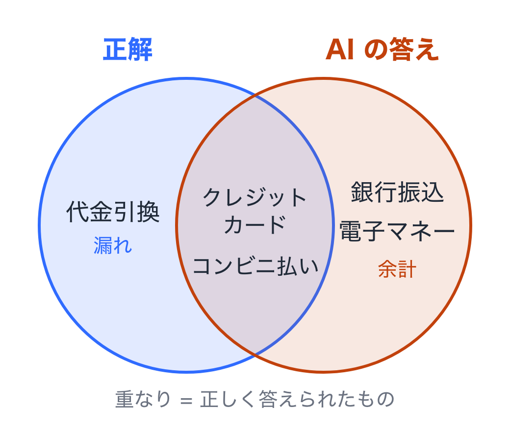

AI を使ったアプリを作ると、必ずぶつかる問いがあります。「このモデルで十分なのか」「プロンプトを直したら良くなったのか、悪くなったのか」。

ここで言う**モデル**は、ChatGPT や Claude の中身にあたる AI 本体のことです。同じ会社のものでも、賢いが高くて遅いもの、少し劣るが安くて速いものなど、何種類も用意されています。**プロンプト**は、AI に渡す指示文のことです。

この問いに答えるには、AI の出力を測る仕組みが要ります。これを **evals**（評価）と呼びます。この記事は、10 分のショートトークで話した内容を文章にしたものです。数式はほとんど使わず、通販サイトの問い合わせ AI を例に進めます。

論文に基づく詳しい話は、元記事「[AI は答え合わせはできても問題集は作れない](https://singularitysociety.org/articles/tech-blog/2026-10-22-llm-eval-authoring-grading-routing-survey/)」にまとめてあります。

---

## evals とは

AI の出力を、決めた問題と基準で測ることです。目的は 2 つあります。

1. **モデルの評価** ── どのモデルが賢いかを比べる
2. **自分のシステムの評価** ── 自分のアプリで、ちゃんと動くかを確かめる

1 つ目は、雑誌の家電比較のようなものです。2 つ目は、買ってきた家電が**自分の家の**コンセントや置き場所で使えるかを確かめることにあたります。

実務で欲しいのは、いちばん賢いモデルではありません。**必要な性能を持つ、いちばん安くて速いモデル**です。それを選ぶには、「必要な性能」を測れなければなりません。測れないと、念のためいちばん高いモデルを使い続けることになります。

---

## ベンチマークとは

ベンチマークは、**問題と正解のセット**と、**採点の仕方**の組み合わせです。AI に全部解かせて、点数で比べます。

学校の試験にたとえると分かりやすいです。問題用紙と模範解答があって、採点の基準が決まっている。生徒の代わりに AI が解く、というだけです。

通販サイトの問い合わせ AI なら、たとえばこうなります。

| 問題 | 正解 |
|---|---|
| 返品できるのは、購入から何日以内？ | 30 日以内 |
| 送料が無料になるのは、いくらから？ | 5,000 円以上 |
| 支払いに使えるのは？ | クレジットカード、コンビニ払い、代金引換 |

採点の仕方は、たとえば「正解と一致すれば 1 点」。100 問中 92 問正解なら 92 点です。

### 問題集は、使い道ごとに分ける

集めた問題は、そのまま全部を同じ用途に使ってはいけません。返品についての問い合わせを例に、3 つに分けます（送料や支払いの問い合わせも同じように分けます）。

| 分け方 | 使い道 | 例（どれも返品の質問） |
|---|---|---|
| **組み込む例** | プロンプトに入れる手本（数件） | 「返品は何日以内？」→「30 日以内」 |
| **チューニング用の評価** | プロンプトなどを改善するたびに回す | 「セールで買った服も返品できる？」 |
| **最終評価** | 本番に出す前に 1 回だけ回す | 「開封した化粧品は返品できる？」 |

学校で言えば、組み込む例は教科書の例題、チューニング用の評価は練習問題、最終評価は本番の試験です。例題を見て解き方を覚え、練習問題で何度も腕試しをして、最後に初めて見る試験問題で実力を測ります。

**チューニング**は、プロンプトの言い回しや、AI に渡す資料などを少しずつ直して、点を上げていく作業のことです。

守ることは 2 つです。

- 最終評価の質問は、**改善するときに見ない**
- 同じ質問の言い換えは、**別々の組に分けない**

どちらも、守らないと点が実力より高く出ます。具体的に見ていきます。

### 失敗する例

チューニング用の評価に、次の質問が入っていたとします。

> セールで買った服も返品できる？（正解: できない。セール品は返品不可）

最初、AI は「30 日以内なら返品できます」と答えて不正解でした。そこでプロンプトに「セール品は返品できません」と書き足しました。これで正解するようになります。ここまでは、チューニングとして正しい作業です。

ところが、最終評価の側に、次の質問が入っていたとします。

> バーゲンで買ったシャツは返品できますか？

言葉は違いますが、聞いていることはさっきと同じです。セール品の返品です。プロンプトに答えを書き足したのですから、AI は当然正解します。

最終評価で確かめたかったのは、「**まだ試していない質問**にも正しく答えられるか」でした。ところがこの 1 問は、チューニングの段階で答えを教えた問題と実質同じです。最終評価が 90 点と出ても、その中には「答えを教えたから当たった問題」が混じっています。本番で初めて来る質問に対しては、90 点より低いかもしれません。

### 直し方

「セールで買った服も返品できる？」と「バーゲンで買ったシャツは返品できますか？」は、**同じ組に入れます**。どちらもチューニング用にするか、どちらも最終評価にするかです。

そして、最終評価の質問を見て、プロンプトを直してはいけません。「最終評価のこの問題で間違えたから、プロンプトに書き足そう」とすると、同じことが起きます。最終評価は、本番に出す前に 1 回だけ回して、出た点をそのまま受け取ります。

試験問題を前もって見せてから試験をしたら、高い点が出ても実力とは言えません。言い換えを分けるのは、言い換えた問題をこっそり見せるのと同じことです。

機械学習では「学習用・検証用・テスト用」と呼ばれる分け方です。ただし大量の学習データが要るのはモデル自体を追加で学習させるときで、問い合わせ AI では手本は数件をプロンプトに入れ、規約などの知識は検索して渡すのが普通です。決まった比率もありません。

---

## 自分のシステムには、専用のベンチマークが要る

| | モデルの評価 | 自分のシステムの評価 |
|---|---|---|
| 測るもの | どのモデルが賢いか | **自分のアプリが動くか** |
| 問題集 | MMLU、SWE-bench など、公開されたもの | **ない。自分で作る** |

MMLU は大学レベルまでの幅広い科目の選択問題集、SWE-bench は実際のソフトウェアの不具合を直せるかを試す問題集です。モデルを発表するとき、各社がこうした問題集での点を載せます。

公開ベンチマークの点が高くても、自分のタスクでうまくいくとは限りません。返品規定を正しく答えられるかは、自分の規定で試すまで分からないからです。全国模試で偏差値が高い人でも、自分の会社の社内規定についての質問には、規定を読ませてみるまで答えられるか分かりません。

そして、**作って終わりではありません**。

1. 自分のシステム用の**ベンチマークを作る**
2. **定期的に回す**
3. **モデルや仕組みを変えるたびに回す**（モデルの乗り換え、プロンプトの修正など）

健康診断のようなものです。一度測って終わりではなく、定期的に、そして何かを変えたときに測ります。プロンプトを 1 行直しただけで、別の質問の答えが崩れることは珍しくありません。モデルは提供元が更新することもあるので、こちらが何も変えていなくても定期的に測る意味があります。

---

## 評価を作るのは難しい

難しさは 4 か所にあります。この先の節は、この順に見ていきます。

| | 何が難しいか |
|---|---|
| **評価関数** | 「正しい」を数字にするのが難しい |
| **採点方法** | 機械・AI・人、どれにも弱点がある |
| **問題の作り方** | 易しすぎても、難しすぎても役に立たない |
| **評価のコスト** | 問題を増やすほど、時間とお金がかかる |

---

## 評価関数と、評価の集計

ここで言葉を 2 つに分けておきます。試験で言えば、評価関数は 1 問ずつ丸かバツかを付けること、評価の集計は丸の数を数えて点数を出すことです。

**評価関数**は、1 つの答えが合っているかを決めるものです。いろいろあります。

| 評価関数 | 向いている答え |
|---|---|
| **機械的な一致** | 答えが短く決まっている（日付、金額、選択肢） |
| テストを実行する | プログラム |
| 数値の誤差を許す | 計算結果（差が 1% 以内なら正解、など） |
| 文の重なり・意味の近さ | 翻訳、要約 |
| **LLM-as-a-judge** | 自由に書いた文章 |
| 人が見る | 最後の確認、基準づくり |

「文の重なり」は、模範解答と同じ単語がどれだけ出てくるかで点を付ける方法です。「意味の近さ」は、言葉が違っても意味が近ければ高い点にする方法です。**LLM** は ChatGPT のような文章を扱う AI のことで、LLM-as-a-judge は「AI を採点者として使う」という意味です。上ほど機械的で安く、下ほど柔軟ですが手間とお金がかかります。

**評価の集計**は、評価関数の結果を集めて点数にするものです。正解率（100 問中何問正解したか）や **F1** がこれにあたります。

以下では、評価関数から「機械的な一致」と「LLM-as-a-judge」を、評価の集計から F1 を取り上げます。

---

## 評価関数（機械的な一致）

AI の答えの文字と、正解の文字を機械で比べる方法です。速くて安く、何度やっても同じ結果になります。ただし、正解が「30 日以内」のとき、文字の比べ方によって弱点が違います。

| 判定の仕方 | 弱点 |
|---|---|
| **完全一致** | 「３０日以内」（全角）や「30 日以内です」も不合格になる |
| **部分一致** | 「30 日以内**ではありません**」も合格になる |
| **揃えてから一致** | 全角・半角は揃えられても、送り仮名や漢字とかなの違いは揃えきれない |

完全一致は 1 文字でも違えばバツ、部分一致は正解の文字が答えのどこかに含まれていれば丸です。揃えてから一致は、比べる前に全角を半角に直す、空白を消す、といった下ごしらえをしてから比べる方法です。

日本語は特に表記の揺れが多い言語です。「申し込み / 申込み / 申込」はどれも正しい書き方ですが、文字列としては別物です。人が見れば同じ意味だと分かることでも、機械はそうは見ません。

いちばん効く対策は、**答えの形を先に決めておく**ことです。選択式にする、「答え: 30」の形で最後に書かせる、などです。マークシートの試験が採点しやすいのと同じで、答える側の自由を減らすと、採点がぶれなくなります。数学の問題集 GSM8K が答えを `#### 30` の形で書かせているのも、このためです。

---

## 評価関数（LLM-as-a-judge）とその問題点

文章で答える問い合わせは、一致では判定しきれません。そこで、答えが正しいかを AI に判定させます。これが **LLM-as-a-judge** です。採点用の指示と、問題・正解・AI の答えを渡して、「この答えは正しいか」を聞きます。人が 1 件ずつ読むより、ずっと速くて安く済みます。便利ですが、採点する AI には癖があります。

- **自分に甘い** ── 自分と同系統のモデルの答えを高く付ける
- **位置で点が動く** ── 2 つの答えを並べたとき、順番を入れ替えるだけで点が変わる
- **長い答えに甘い** ── 中身が同じでも、長いほうを良いと判定しがち
- **自分が間違えた問題で危ない** ── 採点する AI が自分でも間違える問題では、同じ間違いをした答えを正しいと判定しやすい

人間の採点者にも似た癖があります。自分の教え子の答案に甘くなる、最初に読んだ答案が基準になる、長く書いてあると頑張ったように見える、自分が勘違いしている問題では同じ勘違いに丸を付けてしまう。AI の採点者にも、同じことが起きます。

対策は、採点する AI を複数にする、並べる順番を入れ替えて 2 回採点する、そして**採点の基準を具体的に書く**ことです。「丁寧か」ではなく「返品期限の 30 日に触れているか」のように書きます。

---

## 評価の集計（F1）

「支払いに使えるのは？」のように、正解が複数ある問題を考えます。正解は 3 つ、AI はそのうち 2 つを当て、正解にないものを 2 つ足しました。これを**集合**で見ます。集合は「ものの集まり」のことで、図では円で表します。



- **適合率** = 重なり ÷ AI の答え = 2 ÷ 4 = **0.5**（AI の答えのうち、正しかった割合）
- **再現率** = 重なり ÷ 正解 = 2 ÷ 3 = **0.67**（正解のうち、AI が拾えた割合）
- **F1** = 2 つを合わせた点 = **0.57**

適合率は「言ったことのうち、どれだけ当たっていたか」、再現率は「言うべきことのうち、どれだけ言えたか」です。新型コロナの検査で言えば、適合率は「陽性と出た人のうち、本当に感染していた人の割合」、再現率は「感染していた人のうち、陽性と出た人の割合」にあたります。

**余計**が増えると適合率が下がり、**漏れ**が増えると再現率が下がります。片方だけ見ると、ずるい答えが高く出ます。全部の支払い方法を並べれば再現率は 1 になり、1 つだけ確実なものを答えれば適合率は 1 になります。F1 は両方が高いときだけ高くなります。2 つを足して割る普通の平均ではなく、低いほうに引っ張られる平均の取り方をしているからです。適合率が 1 でも再現率が 0.1 なら、普通の平均は 0.55 ですが、F1 は約 0.18 です。

式はこうです。

```
F1 = 2 × 適合率 × 再現率 ÷ (適合率 + 再現率)
   = 2 × 0.5 × 0.67 ÷ (0.5 + 0.67) ≈ 0.57
```

---

## 問題を作るのは難しい

ベンチマークの「問題と正解」は、AI に作らせたくなります。ところが、AI は**判定**は得意でも、**作成**は苦手です。

| AI に頼むこと | 結果 |
|---|---|
| **判定** ──「この答えは正しい？」 | よく当たる |
| **作成** ──「正解を全部書いて」 | **漏れ**が多い |

たとえば「支払い方法の正解を全部書いて」と頼むと、代金引換が抜ける、といったことが起きます（説明のための例です）。

なぜ判定は得意で作成は苦手なのか。判定は、目の前の答えを 1 つ見て「合っているか」を考えればよいからです。作成は、目の前にないものまで含めて「全部」を思い浮かべなければなりません。人間でも、「この中に間違いはある？」と聞かれれば答えられるのに、「抜けているものを全部挙げて」と言われると難しいのと同じです。

プログラムの問題で、これを実際に測った研究があります（[Judging Is Not Enumerating](https://arxiv.org/abs/2608.01000)、2026 年）。

- 提出されたプログラムが仕様を満たすかを AI に**判定**させると、F1 は 0.74〜0.90。まずまず当たる
- 同じ AI に、そのプログラムを確かめるテスト（「この入力ならこの出力になるはず」という確認の一覧）を**書かせる**と、そのテストは、正しいと分かっているプログラムの 19〜42% しか合格にしなかった。つまり、**正しいプログラムの半分以上を不合格にした**

落とした理由は、AI が**仕様に書かれていない条件をテストに勝手に足した**ことでした。たとえば「並べ替える」という仕様に、「空のリストならエラーを出すこと」というテストを足す。空のリストに空のリストを返すプログラムは仕様どおりで正しいのに、不合格になります（この例も説明用です）。

厄介なのは、漏れや余計な条件は「書かれていない」か「もっともらしく書かれている」ので、読み返しても**気づきにくい**ことです。

だから、AI が作った正解表やテストは、**正しいと分かっている答えで一度試してから**使います。正しい答えが不合格になったら、正解表のほうが間違っています。

---

## 差がつく問題だけが効く

10 問のテストで、A は 90 点、B は 80 点でした。ところが中身を見ると、

- 8 問は両方とも正解
- 1 問は両方とも不正解
- **差を作ったのは、残りの 1 問だけ**

全員が解ける問題も、全員が解けない問題も、モデルの違いについて**何も測っていません**。問題は「難しさ」ではなく、「**差がつくかどうか**」で選びます。

入社試験で全員が満点を取る問題を出しても、誰を採るかは決められません。全員が 0 点の問題も同じです。決め手になるのは、できる人とできない人が分かれる問題だけです。

公開ベンチマークで、使う問題集を変えると順位が入れ替わることがあるのも、このためです。そのベンチマークに、その水準で差がつく問題が残っていないのです。

---

## 評価のコスト

問題を増やすほど、毎回の評価にお金と時間がかかります。モデルやプロンプトを変えるたびに回すなら、なおさらです。

AI の利用料は、たいてい読ませた文字の量と書かせた文字の量で決まります。1000 問のベンチマークを 1 回回せば 1000 回分の料金がかかり、それをプロンプトを直すたびに繰り返します。

- 増やすより先に、**差がついていない問題を外す**
  - 答えを見ながら次の問題を選ぶやり方（正解したら次はもっと難しい問題を、間違えたら易しい問題を出す）で、**約 10 問**で全体の点をほぼ復元できた例があります（[Item Response Theory for AI Safety](https://arxiv.org/abs/2608.05086)、安全性のベンチマークでの結果）
- 評価ができれば、**安いモデルへの振り分け**ができる
  - 簡単な問い合わせは安いモデルに、難しいものだけ高いモデルに回す。病院の受付で、軽い症状は近所の医院へ、重い症状は大病院へ案内するのに似ています。ただし現場からは「安くする仕組みより、**安くして大丈夫かを測る**ほうが大変」という声が繰り返し挙がっています

---

## なぜ vibe coding が先に進んだのか

AI にコードを任せる使い方（vibe coding、細かい中身は AI に任せて、雰囲気で指示しながら作っていくやり方）は、ほかの分野より先に広まりました。理由は 2 つです。

1. **データが豊富** ── 公開されたコードが大量にある
2. **評価がしやすい** ── テストを実行すれば、正しいかどうかが機械的に決まる

プログラムには、正しいかどうかを機械で確かめる道具が昔から揃っていました。AI が書いたコードも、動かしてみれば合っているか分かります。だから AI の改良も、AI を使う側の工夫も、すぐに結果を見ながら進められました。

**確かめやすい分野ほど、AI は速く伸びます。** 裏返すと、ほかの分野で AI を使うときの壁も「**評価できるかどうか**」です。

自分の問い合わせ AI、自分の社内ツールで AI を使うなら、最初に作るべきものはプロンプトではなく、それを測るベンチマークかもしれません。

---

## 参考文献

- [Judging Is Not Enumerating](https://arxiv.org/abs/2608.01000)（arXiv:2608.01000, 2026）── 判定と作成の差
- [Item Response Theory for AI Safety](https://arxiv.org/abs/2608.05086)（arXiv:2608.05086, 2026）── 約 10 問で点を復元
- [Judging LLM-as-a-Judge with MT-Bench and Chatbot Arena](https://arxiv.org/abs/2306.05685)（Zheng ら, arXiv:2306.05685, 2023）── 位置や長さによる採点の癖
- [Self-Preference Bias in Rubric-Based Evaluation](https://arxiv.org/abs/2604.06996)（arXiv:2604.06996, 2026）── 自分に甘い採点
- [Do LLM Evaluators Prefer Themselves for a Reason?](https://arxiv.org/abs/2504.03846)（arXiv:2504.03846, 2025）── 自分が間違えた問題での採点
- [RouteLLM](https://arxiv.org/abs/2406.18665)（arXiv:2406.18665, 2024）── モデルの振り分け
- 元記事: [AI は答え合わせはできても問題集は作れない — LLM 評価とモデル選択の論文を読む](https://singularitysociety.org/articles/tech-blog/2026-10-22-llm-eval-authoring-grading-routing-survey/)
