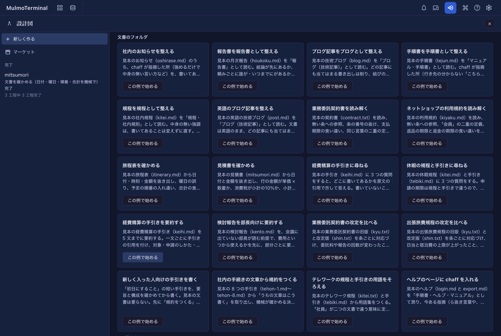
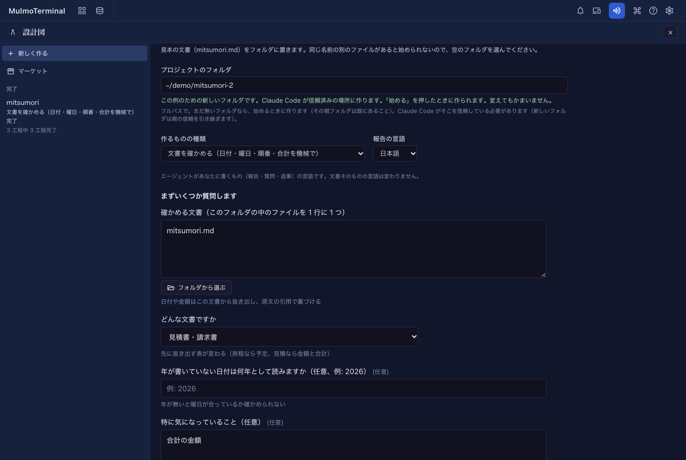
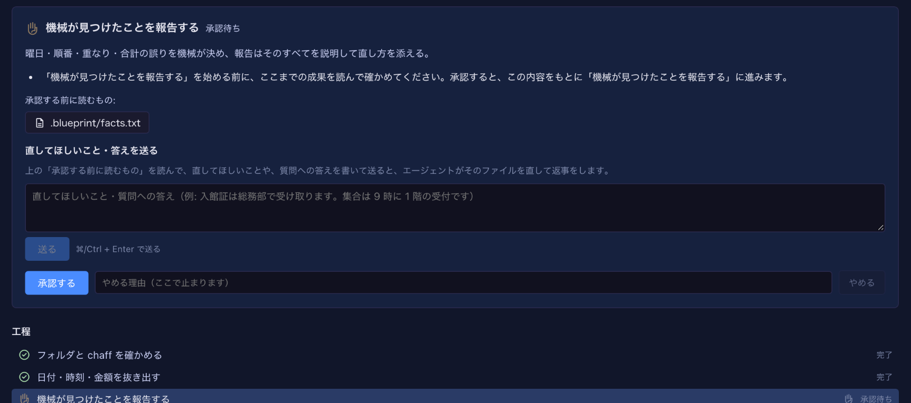
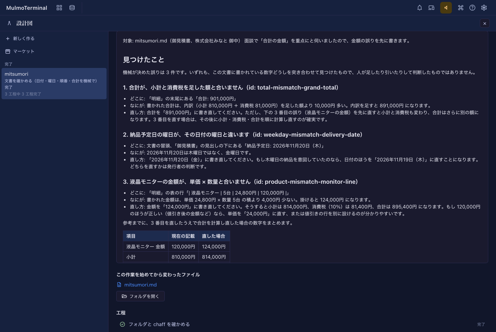
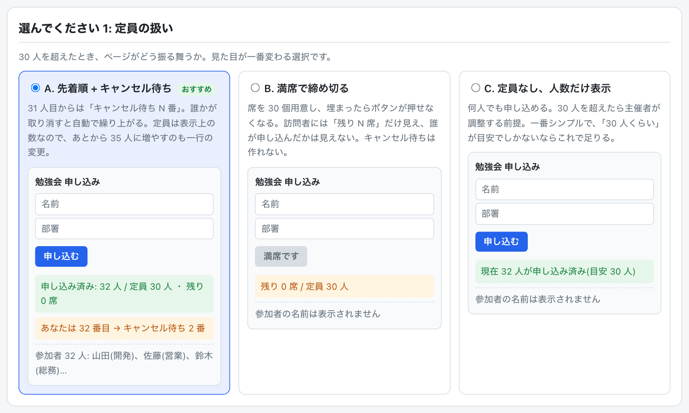
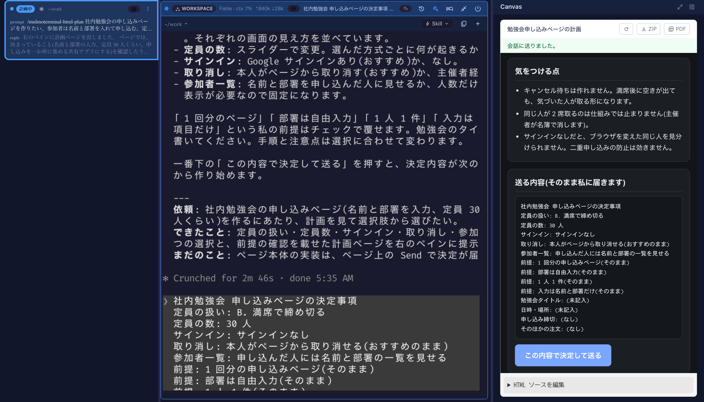
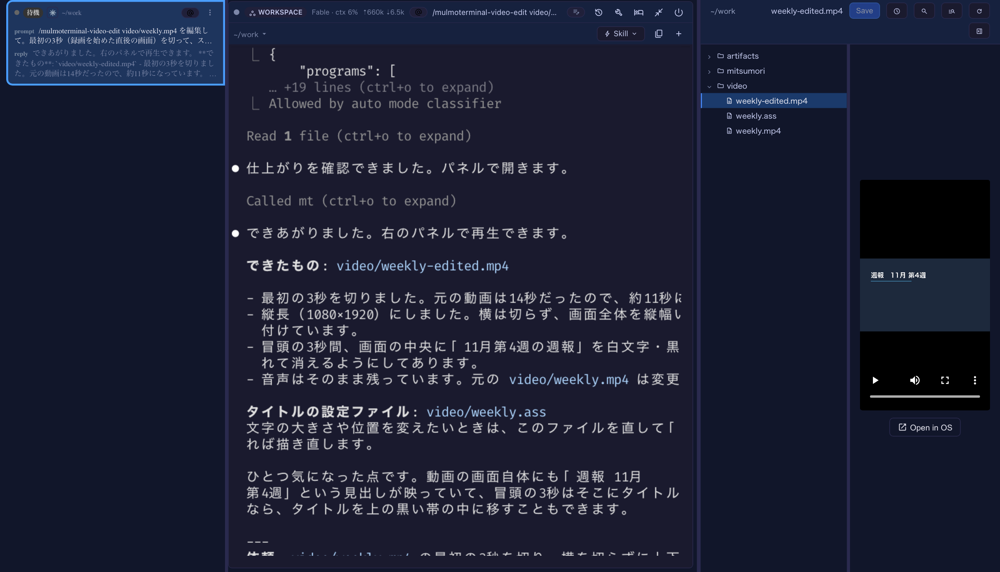
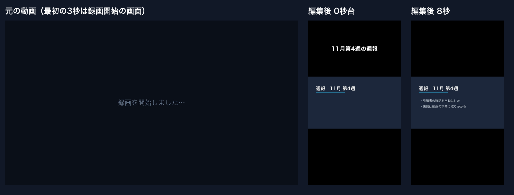

取引先から見積書が届きます。

明細を上から読んで、単価と数量を電卓で掛け、小計を足し、消費税を出して、合計と見比べます。納品の日付の横の曜日も、カレンダーで確かめます。明細が三行しかない見積書でも、きちんと確かめるとそれなりに時間がかかります。それでも、どこかで一つ見落としていないかは、最後まで分かりません。

AI に見積書を貼って「間違いはありますか」と聞けば、それらしい答えは返ってきます。ただ、AI は計算をしているわけではありません。正しい合計を「間違っています」と言うこともあれば、本当の間違いを見逃すこともあります。結局、AI の答えをもう一度電卓で確かめることになります。

そんな経験はないでしょうか。

## AI に頼むと、確かめる手間が残る

AI に仕事を頼むと、たいていの作業は速くなります。その代わりに、出てきたものを人が確かめる手間が残ります。

見積書の検算はその典型です。AI の答えが合っているかどうかは、答えを読んでも分かりません。自分で計算し直すしかないなら、最初から自分で計算したのと変わりません。

計画の相談でも、動画の編集でも、形は違っても同じことが起きます。AI は長い文章で答えを返してきて、人はそれを読み、文字で返事を書き、思ったとおりになったかを確かめます。頼むことより、その前後のやり取りのほうに手間がかかります。

## 手間の置き場所を変える

この記事では、[MulmoTerminal](https://github.com/receptron/mulmoterminal) の中から、その前後の手間を減らす使い方を3つ紹介します。

MulmoTerminal は、Claude Code や Codex などの AI のコーディング道具を、ブラウザの中で何個も並べて動かすためのアプリです。自分のパソコンに入れて、ブラウザで開いて使います。MIT ライセンスの無料のソフトウェアです。

3つに共通しているのは、AI に任せるところと、機械に任せるところと、人が決めるところを分けていることです。見積書の検算なら、数字を拾うのは AI ですが、計算が合っているかを決めるのはプログラムです。人は、そのプログラムが何を見つけたかを読むだけで済みます。

## 1. 見積書を機械に検算させる

MulmoTerminal の「設計図」には、文書を扱う作業がいくつか入っています。その一つが「文書を確かめる」です。旅程表や見積書から日付と金額を抜き出し、曜日の誤り、予定の順番の入れ違い、合計の食い違いを、機械で見つけます。

手元に文書が無くても、見本の文書で試せます。設計図の画面の「例から始める」の「文書のフォルダ」に、20個の例が並んでいます。ここでは「見積書を確かめる」を使います。



見本の見積書は、次のような Markdown のファイルです。

```markdown
# 御見積書

株式会社みなと 御中

発行日: 2026年10月15日（木）
有効期限: 2026年10月30日（金）
納品予定日: 2026年11月20日（木）

## 明細

| 品目 | 数量 | 単価 | 金額 |
|---|---|---|---|
| ノートパソコン | 5台 | 128,000円 | 640,000円 |
| 液晶モニター | 5台 | 24,800円 | 120,000円 |
| 初期設定の作業 | 1式 | 50,000円 | 50,000円 |

小計: 810,000円
消費税（10%）: 81,000円
合計: 901,000円
```

この見積書には、わざと間違いが3つ入れてあります。読みながら探してみると、意外と見つからないものです。

### 聞かれたことに答える

「この例で始める」を押すと、答えが入った状態のフォームが開きます。確かめる文書、文書の種類（旅程表か、見積書か、それ以外か）、年が書いていない日付を何年として読むか、特に気になっていること、の4つを聞かれます。例では、気になっていることに「合計の金額」と入っています。



質問ごとに、なぜそれを聞くのかが小さく書かれています。年を聞くのは、年が無いと曜日が合っているか確かめられないからです。

「始める」を押すと、新しいフォルダに見本の見積書が置かれ、作業が始まります。

### 抜き出したものを、承認の前に読む

作業は3つの工程に分かれています。フォルダの準備、日付と金額の抜き出し、見つけたことの報告です。

抜き出しが終わると、作業は止まって承認を待ちます。報告に進む前に、抜き出した値を人が読めるようにするためです。



抜き出した値は `.blueprint/facts.txt` に書かれています。中身は次のような一覧です。

```text
- 2026-11-20（木） 納品予定日 · mitsumori.md 「御見積書」
- 液晶モニター 数量 5 台 · mitsumori.md 「明細」
- 液晶モニター 単価 24,800 円 · mitsumori.md 「明細」
- 液晶モニター 金額 120,000 円 · mitsumori.md 「明細」
- 合計 901,000 円 = 小計 + 消費税 · mitsumori.md 「明細」
- 液晶モニター 金額（単価×数量） 120,000 円 = 液晶モニター 単価 × 液晶モニター 数量 · mitsumori.md 「明細」
```

（実際には日付が3件、金額や数量が12件、合計と掛け算の関係が6件並びます。ここでは一部だけ載せています。）

ここで AI がしているのは、文書から値を拾い、どの値とどの値が「足す」「掛ける」の関係にあるかを書き出すことだけです。計算はしていません。拾った値が本当に原文にあることも、引用を照らし合わせて確かめています。

抜き出しに間違いがあれば、欄に書いて送ると直してもらえます。問題がなければ「承認する」を押します。

### 間違いを決めるのはプログラム

報告の工程では、抜き出した値に対して、プログラムが規則を当てていきます。日付の横の曜日がその日付の曜日と合っているか、合計が内訳の和になっているか、金額が単価と数量の積になっているか、といった規則です。今回は7つの規則が走りました。

報告はこうなりました。



見つかった間違いは3つで、入れておいた3つと一致しました。

- 合計の 901,000円 は、小計 810,000円 と消費税 81,000円 を足した 891,000円 より 10,000円 多い
- 2026年11月20日は木曜日ではなく金曜日
- 液晶モニターの 120,000円 は、24,800円 × 5台 の 124,000円 より 4,000円 少ない

それぞれに、どこに書いてあるか、何が違うか、どう直すかが添えられています。直し方には選択肢も書かれていて、たとえば納品日なら「曜日を金曜に直すか、木曜に納品するつもりなら日付を19日に直すか」です。どちらを直すかは発行した人が決めることなので、報告は決めつけません。

液晶モニターの金額を直すと、小計も消費税も合計も変わります。報告の最後には、直した場合の数字が表にまとめてあります。一つ直すと別の数字がずれる、という連鎖まで追ってくれるので、直す側はその表のとおりに書き換えれば済みます。

### なぜ AI に聞くのと違うのか

報告の中で「間違っています」と決めているのは、規則を書いたプログラムです。AI に任せたのは、文書から値を拾うことと、見つかったことを人が読める文章にすることです。その間の「合っているかどうか」には、AI は関わっていません。

AI に「間違いはありますか」と聞いたときに困るのは、答えを確かめる方法が自分で計算し直すことしかない点でした。この作業では、抜き出した値の一覧を承認の前に読めて、その値が原文にあることも確かめてあります。値さえ合っていれば、計算は間違えません。

同じ作業で、旅程表も確かめられます。曜日の誤りに加えて、予定の順番の入れ違いや、時間の重なりも見つけます。

## 2. 計画をページにして決める

AI に「計画を立てて」と頼むと、長い文章が返ってきます。案が三つ並び、それぞれに長所と短所が書いてあって、最後に「どれにしますか」と聞かれます。読んで、頭の中で画面を思い浮かべ、「B で。あとサインインは無しで」と打ち返します。

MulmoTerminal に入っている `/mulmoterminal-html-plan` は、この計画をページにして見せるスキルです。スキルは、Claude Code に決まった手順で仕事をさせるための指示書で、セルの中で `/` から始まる名前を打つと使えます。

### 頼む

ここでは、社内勉強会の申し込みページを作る計画を頼みました。Claude のセルで、次のように打ちます。

```text
/mulmoterminal-html-plan 社内勉強会の申し込みページを作りたい。参加者は名前と部署を入れて申し込む。定員は30人くらい。計画を見せて、選ばせてほしい。
```

Claude は作業のフォルダと関係する仕組みを読み、三分ほどでターミナルの右にページを開きました。

### ページで選ぶ

ページの頭には、決まっていること（名前と部署を入れる、定員は30人くらい）が並びます。その下に、Claude が勝手にそう思っていることが、チェックボックス付きで並びます。「勉強会は1回分の申し込みページ」「部署は自由入力」「同じ人の二重申し込みは防ぐ」といった前提で、違っていればチェックを入れて覆せます。

本題は「選んでください」の段です。今回は、定員の扱い、定員の数、サインインの有無、取り消し、参加者一覧の見せ方の5つを聞かれました。定員の扱いは、案ごとに申し込み画面の見本が並びます。



31人目が来たとき、A なら「キャンセル待ち2番」と出て、B ならボタンが「満席です」になり、C なら人数が増えていくだけです。文章で三つの案を説明されるより、見比べたほうが早く決まります。おすすめの案には印が付いていて、最初から選ばれています。

選ぶと、ページの下のほうも変わります。B を選ぶと、「気をつける点」に「キャンセル待ちは作れません」と出ました。サインインを無しにすると、「ブラウザを変えた同じ人を見分けられません」が加わります。

### 送ると、次のメッセージになる

ページのいちばん下に「送る内容」があり、いまの選択がそのまま文章になって表示されています。「この内容で決定して送る」を押すと、その文章が、あなたの次のメッセージとして Claude に届きます。



届いた文章は、「定員の扱い: B. 満席で締め切る」「サインイン: サインインなし」「取り消し: 本人がページから取り消せる（おすすめのまま）」のように、一行に一つの決定が書かれたものです。選ばなかった項目も「おすすめのまま」として入るので、何が決まったのかが後から読んでも分かります。Claude はこれを受け取って、そのまま作り始めました。

ターミナルで一問ずつ答えていくと、前の答えとの関係が見えにくくなります。ページなら、全部の選択肢を並べて見たうえで、まとめて決められます。

## 3. 話しかけて動画を切り出す

画面を録画すると、最初と最後に要らない部分が入ります。スマホで見てもらうなら縦長にしたいし、冒頭にタイトルも入れたい。動画の編集ソフトを開けばできることですが、そのたびに使い方を思い出すのが面倒です。

`/mulmoterminal-video-edit` は、やりたいことを言葉で伝えると、Claude が ffmpeg（動画を変換するための定番の道具）のコマンドを組んで編集するスキルです。

### 頼む

素材は、14秒の週報の動画です。最初の3秒は「録画を開始しました…」の画面で、そのあとに週報のスライドが続きます。Claude のセルで、次のように頼みました。

```text
/mulmoterminal-video-edit video/weekly.mp4 を編集して。最初の3秒（録画を始めた直後の画面）を切って、スマホ用に縦長にして（横は切らずに上下に帯を付けて）、冒頭に「11月第4週の週報」というタイトルを3秒出して。
```

Claude はまず動画の長さや大きさを調べ、タイトル用のファイルを書いて、一回の変換で仕上げました。1分ほどで終わり、できた動画はターミナルの右のペインでそのまま再生できます。



元の `weekly.mp4` はそのまま残り、`weekly-edited.mp4` が新しくできます。タイトルの文字や位置は `weekly.ass` という別のファイルに書かれていて、あとから直せます。

### 気づいたことを言ってくる

報告の最後に、Claude はこう書いていました。動画の画面にも「週報 11月 第4週」という見出しが映っているので、冒頭の3秒はタイトルと重なる。気になるなら、タイトルを上の黒い帯に移せる、と。

「タイトルを上の黒い帯に移して」と頼むと、タイトルの位置を直して描き直しました。こちらは20秒もかかりませんでした。



ほかにも、速さを変える、音の大きさをそろえる、音楽を差し替える、複数の動画をつなぐ、といったことを頼めます。話している内容から字幕を作ることもできます。字幕の文字起こしは手元のパソコンの中で行い、動画や音声をどこかに送ることはありません。ただし、そのためには whisper.cpp の `whisper-cli` と音声認識のモデル（小さいもので約490MB）が要ります。今回は入れていないので、字幕は試していません。

## 試してみる

必要なものは次のとおりです。

- Node.js 22.13 以上と git
- Claude Code と、それを使うための Claude の有料プラン（無料プランでは Claude Code は使えません）
- 動画の編集には ffmpeg（Mac なら `brew install ffmpeg`）。話から字幕を作るなら、加えて whisper.cpp（`brew install whisper-cpp`）とモデル

ターミナル（Windows なら PowerShell、Mac ならターミナル）で次を実行し、ブラウザで `http://localhost:34567` を開きます。

```bash
npx mulmoterminal@latest
```

設計図は、上のバーの「その他の機能」のメニューにあります。設計図のエージェントは、誰も見ていないところで動きます。Claude Code の「このフォルダを信頼しますか」の確認で止まると先へ進めないので、試し用の親フォルダを作り、そこで一度 `claude` を起動して信頼すると答えておきます。その中に作るフォルダは、親の信頼を引き継ぎます。

2つのスキルは、Claude のセルで `/mulmoterminal-html-plan` や `/mulmoterminal-video-edit` と打って使います。どちらも、ページや動画をターミナルの右に開くための道具（MulmoTerminal の GUI ツール）を使います。起動の画面の WORKSPACE から始めたセルなら、最初から使えます。自分のプロジェクトのフォルダで使うときは、セルを始める前に、そのフォルダで Canvas の道具をオンにしておきます。

## まとめ

AI に仕事を頼むと、頼んだあとの手間が残ります。答えが合っているかを確かめる手間、長い文章を読んで返事を書く手間、思ったとおりにできたかを見る手間です。

見積書の検算では、間違いかどうかを決める部分をプログラムに任せ、人は抜き出した値と報告を読むだけにしました。計画の相談では、選択肢をページに並べ、選んだ結果をそのまま次のメッセージにしました。動画の編集では、コマンドを書く部分を AI に任せ、結果はターミナルの横で再生して確かめました。

三つとも、AI に任せるところ、機械に任せるところ、人が決めるところを分けて、人の手間がいちばん少なくなるように並べ直したものです。AI に頼む仕事が増えるほど、この並べ方の差が効いてきます。
