AI でバイブコーディングすると、ごちゃごちゃしていたり、文字の説明が多かったりする、複雑な画面が出来上がってしまうことが多いです。

Web デザイナーや UI デザイナーと一緒に仕事をしたことがないと、具体的にどう直せばよいか、なかなか分かりません。「なんとなく使いにくい」までは分かる。でも、どこをどう変えれば使いやすくなるのかを、言葉にできない。

そこで、UI 設計で昔から守られてきた原則を、初めての非エンジニア向けに、出典つきでまとめました。全9章、各章に図つきです。もとの連載は [Singularity Society の「開発の心得」](https://singularitysociety.github.io/societys_statement/development/ui_design/README.html) にあり、この記事はそれを一本に通したものです。

どの章も同じ型です。ひとことで言うと何か、なぜそうなのか、避けたい例と改善例、そして出典、の順で書いてあります。図は左が避けたい例、右が改善例です。

---

## まず、三つの合言葉

この連載の出発点になった三つの言い回しです。章を読む前に、まずこれだけ覚えてください。

| 合言葉 | 意味 |
| --- | --- |
| **一貫性をもたせる** | 同じ意味のものは、同じ見た目・同じ場所・同じ言葉で |
| **読まなくても分かる** | 説明文を読まなくても、見れば何ができるか分かる。文字を減らすことであって、文字をなくすことではない |
| **肯定形と否定形をまぜない** | 設定の項目は「〜する」の形にそろえる。「通知を受け取る」の隣に「メールを受け取らない」を置かない |

「読まなくても分かる」は、よく「ノンバーバル」と言われます。ただし「文字をなくしてアイコンだけにする」まで進めると、かえって意味が伝わらなくなります。アイコンには言葉を添えるのが定番の指針です。第2章で扱います。

---

## 第1章　一貫性 ── 同じものは同じ見た目・同じ場所・同じ言葉

**ひとことで。** 同じ意味のものは、画面のどこでも同じ見た目・同じ場所・同じ言葉にします。違う意味のものは、違って見えるようにします。

人は画面を一つずつ読んで理解しているのではなく、「前に見たあれと同じだろう」と推測しながら使っています。一貫性はその推測の土台です。ソシオメディアの指針は、一貫性を「ユーザーがシステムの使い方を推測したり学習したりするための基本的な手がかり」と呼んでいます。

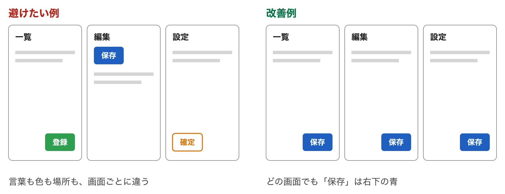
*言葉も色も場所も画面ごとに違う（左）と、どの画面でも「保存」は右下の青（右）*

そろえるものは四つです。

| そろえるもの | 例 |
| --- | --- |
| **見た目** | 「押せるもの」は全部同じ形の青いボタン。リンクは全部下線 |
| **場所** | 保存ボタンを使うなら、どの画面でも右下。閉じる × はどの画面でも右上 |
| **言葉** | 同じ操作には同じ動詞。「保存」「登録」「確定」を画面ごとに変えない |
| **振る舞い** | 同じ操作は同じ結果。ある画面では自動保存、別の画面では保存ボタン、をまぜない |

一貫性には二つの向きがあります。自分のアプリの中でそろっているか（内側）と、世の中の慣習とそろっているか（外側）です。虫眼鏡は検索、× は閉じる、下線はリンク。外側の一貫性が効く理由を、NN/g は「ヤコブの法則」と呼んでいます。利用者はほとんどの時間を他のサイトで過ごしているので、他のサイトと同じ動き方を期待する、という観察です。独自の見せ方を考える前に、まず慣習に合わせるほうが安全です。

### 一貫性はメンタルモデルを作る

利用者は、画面を使いながら「たぶんこう動く」という絵を頭の中に作ります。これがメンタルモデルです。作り手にも絵があります。「この仕組みはこう動く」という設計の絵で、ノーマンはこれを概念モデルと呼びます。ただし作り手は、その絵を利用者に直接は渡せません。渡せるのは画面だけです。

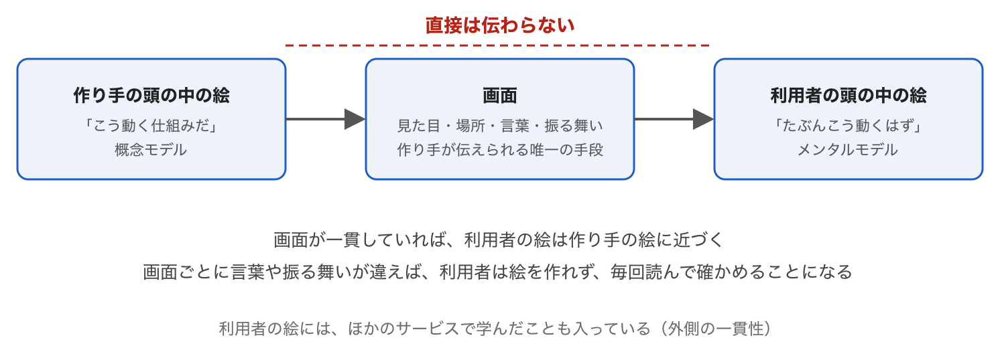
*作り手の絵は、画面を通してしか伝わらない*

同じ意味のものが同じ見た目・場所・言葉で出てくれば、利用者は一度学んだことを次の画面にも当てはめられます。画面ごとに違えば、絵は作れず、毎回読んで確かめることになります。

| 避けたい例 | 改善例 |
| --- | --- |
| 一覧画面では「登録」、編集画面では「保存」、設定画面では「確定」 | すべて「保存」 |
| 主ボタンが青だったり緑だったりする | 主ボタンは一色。副ボタンは枠だけ、と決める |
| 削除ボタンが画面によって右端だったり左端だったりする | 危険な操作は毎回同じ場所に置く |
| 一部の入力欄だけ、入力した瞬間に保存される | 自動保存か保存ボタンか、サービスの中で一つに決める |
| 自分のアプリだけ × が「前の画面に戻る」の意味 | × は閉じる。前の画面に戻るのはブラウザや OS の「←」 |

---

## 第2章　読まなくても分かる ── 手がかりを置き、記憶に頼らず、アイコンには言葉を添える

**ひとことで。** 説明文を読まなくても、見れば「何ができるか」「どう操作するか」が分かる画面にします。文字を減らすのであって、文字をなくすのではありません。

人は画面の文章を読みません。NN/g が1997年に発表した調査の題は「人は Web をどう読むか」、答えは「読まない。拾い読みする」でした。説明文で使い方を補おうとしても、その説明文が読まれないのです。

手段は三つです。

**1. 手がかりを置く。** 押せるものは押せそうに、入力できるところは入力できそうに見せます。この「見せる手がかり」を、ノーマンはシグニファイアと呼びました。

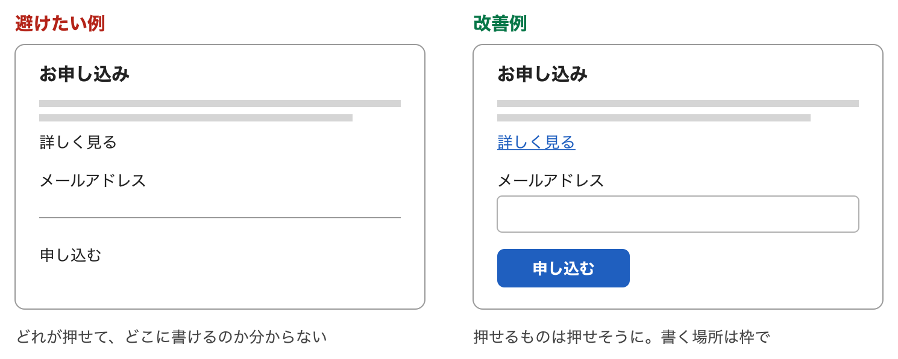
*押せるものは押せそうに。書く場所は枠で*

**2. 記憶に頼らない。** 前の画面で見た番号や、さっき出たメッセージを、利用者が覚えている前提で作ってはいけません。選択肢は見せる、エラーは起きた場所のそばに出す、前の画面の値は次の画面にも出す。NN/g の10原則では「記憶より認識」にあたります。

**3. アイコンには言葉を添える。** 「読まなくても分かる」を「アイコンだけにする」と取り違えると、逆に分からなくなります。NN/g は、ほとんどのアイコンに標準の意味はなく、曖昧さを消すにはテキストラベルが必要だと言い切っています。デジタル庁デザインシステムも、ボタンにはテキストのラベルを持たせることを原則とし、アイコンだけのボタンには必ず代替テキストを指定するとしています。

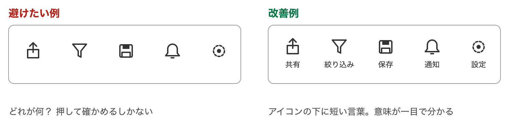
*アイコンの下に短い言葉。意味が一目で分かる*

| 避けたい例 | 改善例 |
| --- | --- |
| 画面の上に「このページの使い方」が5行ある | 使い方が要らないように、ボタンの言葉と並び順を直す |
| アイコンが8個並んだツールバー。意味は長押しで出る | アイコンの下に短い言葉を添える。使わないものは外す |
| 「前の画面で表示された申込番号を入力してください」 | 申込番号を次の画面にも表示する。入力させない |
| 入力エラーが画面のいちばん上にまとめて出る | エラーはその入力欄のすぐそばに出す |

やってみるなら、AI に作らせた画面を、初めて見る人に3秒だけ見せて「この画面で何ができる？」と聞いてください。答えられなければ、手がかりが足りません。この「3秒テスト」は連載の提案で、出典のある手法ではありませんが、説明文を読む前の第一印象を測るには十分です。

---

## 第3章　言葉とスイッチ ── 肯定形にそろえる、ラベルは短く、ボタンは動詞

**ひとことで。** 画面の言葉は、短く、肯定形で、利用者がふだん使う言葉にします。スイッチは「切り替えた瞬間に効く二択」にだけ使い、ボタンの言葉は「押すと何が起きるか」が分かる動詞にします。

**利用者の言葉を使う。** 「ステータス: pending」ではなく「状態: 確認待ち」。「セッションが無効です」ではなく「しばらく操作がなかったので、もう一度ログインしてください」。ソシオメディアの例は航空券の予約で、「NRT」「HND」のような空港コードではなく「成田空港」「羽田空港」を出す、というものです。

**肯定形と否定形をまぜない。** 設定の項目は「〜する」の形にそろえます。否定形が混ざると、利用者は項目ごとに「オンは、する？ しない？」を考え直すことになります。二重否定（「無効にしない」）は、その場で読み解けません。

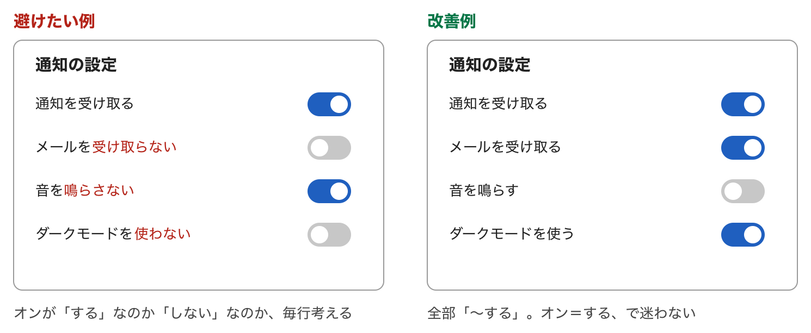
*全部「〜する」。オン＝する、で迷わない*

**部品を使い分ける。** スイッチは、切り替えた瞬間に効く二択にだけ使います。保存や送信を押して初めて効くものには、チェックボックスかラジオボタンです。デジタル庁デザインシステムも、スイッチを「切り替えたら即座に反映される設定項目のためのコントロール」とし、確定動作を要するものにはチェックボックスやラジオボタンを使うとしています。間違えると、利用者は「保存ボタンを押したのに効いていない」「押した覚えがないのに変わっている」と混乱します。

**ボタンの言葉は動詞で、結果が分かるように。** 「OK」「はい」「いいえ」は、何が起きるかを言っていません。NN/g は確認ダイアログについて、はい・いいえではなく、それぞれの選択で何が起きるかを要約した言葉にせよ、と書いています。

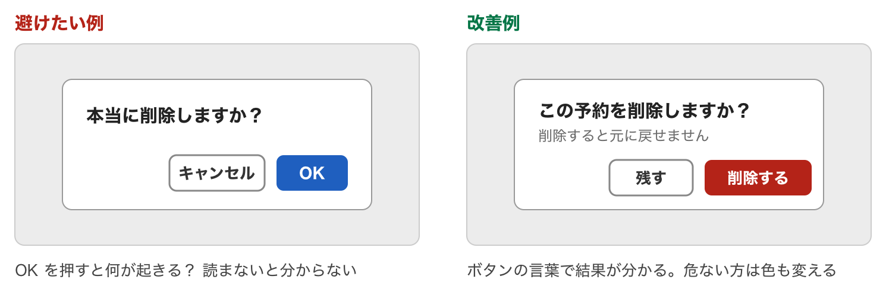
*ボタンの言葉で結果が分かる。危ない方は色も変える*

**入力欄のラベルは欄の上に置き、入力例で代用しない。** 欄の中に薄く出る入力例（プレースホルダー）は、書き始めた瞬間に消えるので、何の欄だったか分からなくなります。

---

## 第4章　状態を伝える・間違いを防ぐ ── フィードバック、取り消し、エラー文、確認

**ひとことで。** いま何が起きているかを常に見せ、間違えにくい形にし、間違えても戻れるようにします。エラー文は起きた場所のそばに、直し方つきで出します。

**状態を伝える。** NN/g の10原則の最初は「システム状態の可視化」です。押したら押したと分かる、保存したら保存したと分かる、待たせるなら待っていると分かる。保存ボタンを押しても画面が変わらないなら、「保存しました」と短く出し、ボタンを一瞬「保存中…」にします。

**取り消せるようにする。** いちばん強い形は「元に戻す」です。確認ダイアログを毎回出すより、実行したあとに「元に戻す」を数秒出すほうが、利用者の手を止めません。メールの送信取り消しがこの形です。

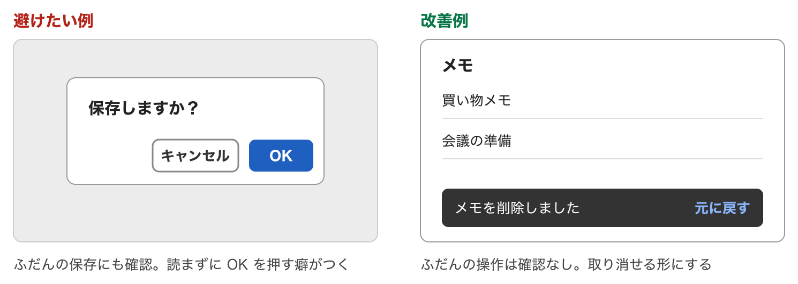
*ふだんの操作は確認なし。取り消せる形にする*

**間違いを防ぐ。** 間違えてから直させるより、間違えられない形にします。日付は自由入力させずカレンダーから選ばせる。在庫がない商品は「入荷待ち」にして押せなくする。終了日に開始日より前の日付を選べないようにする。

**エラー文は、そばに、平易に、直し方つきで。** 起きた場所のすぐそばに、目立つ色で。利用者の言葉で、何が問題かを簡潔に、どう直せばよいかを添えて。入力した内容は消さない。

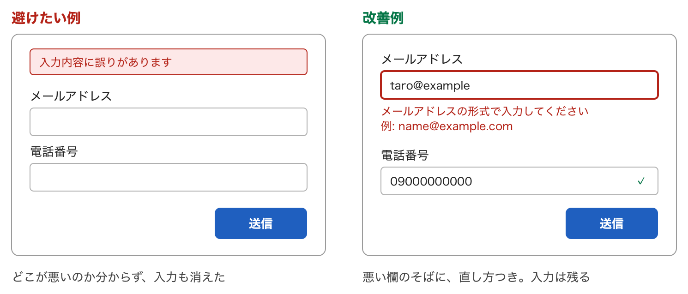
*悪い欄のそばに、直し方つき。入力は残る*

**確認は重大なときだけ。** 確認ダイアログは、出しすぎると読まれなくなります。NN/g は、作業を失う・大きな金額がかかるなど重大な結果を伴う操作の前にだけ使い、日常の操作には使わない、としています。出すときのボタンの言葉は「削除する」「残す」のように結果が分かる動詞にします。

---

## 第5章　配置と量 ── 近いものはまとまる、大きく近いものは押しやすい、選択肢は減らす

**ひとことで。** 関係のあるものを近くに、関係のないものは離して配置します。よく押すものは大きく近くに、危ないものは離して。選択肢は減らし、一画面の主役は一つにします。

**近いものは仲間に見える。** 人の目は、近くにあるものを一つのまとまりとして見ます。線や枠で囲まなくても、距離だけでグループが伝わります。ゲシュタルトの近接の法則です。

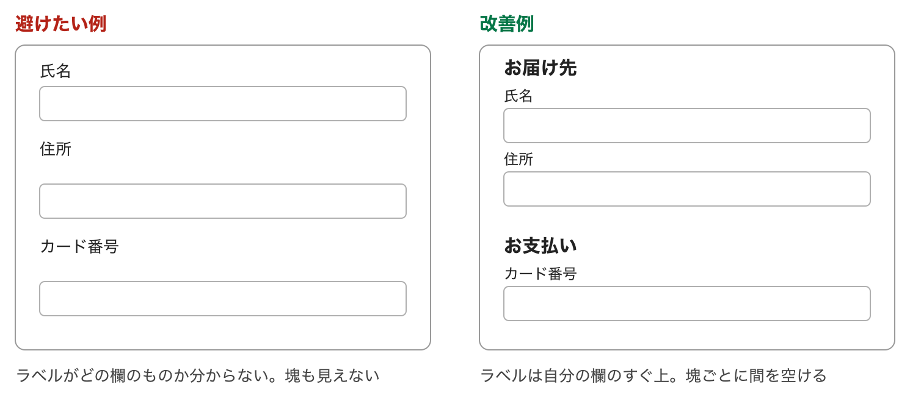
*ラベルは自分の欄のすぐ上。塊ごとに間を空ける*

**大きく近いものは押しやすい。** 目標が大きいほど、近いほど、速く正確に押せます。フィッツの法則です。スマホで文字と同じ大きさのリンクが並んでいたら、指で押せる大きさにして間を空けます。「保存」と「削除」が同じ大きさで隣り合っていたら、削除は離して見た目も変えます。

**選択肢が多いほど迷う。** 選択肢の数が増えるほど、選ぶのに時間がかかります。ヒックの法則です。設定画面に40項目が一列に並んでいるなら、「表示」「通知」「アカウント」に分けて、よく使う項目を上に置きます。

**一画面に主役は一つ。** 関係のない情報は、関係のある情報を見えにくくします。デジタル庁デザインシステムも、いちばん重要な操作のためのプライマリーボタンは「ひとつの画面につき、原則1つまで」としています。

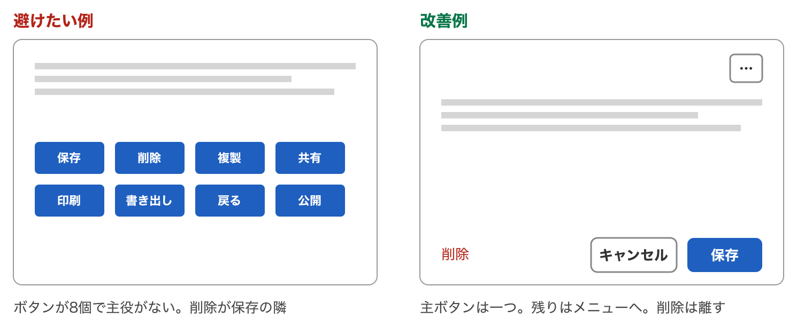
*主ボタンは一つ。残りはメニューへ。削除は離す*

やってみるなら、自分の画面を、目を細めて眺めてください。いくつの塊に見えるか、どこがいちばん目立つかを数えます。塊が多すぎる、主役が二つ以上ある、なら配置を見直します。

---

## 第6章　誰でも使える ── 色だけで区別しない、コントラスト、文字サイズ、キーボード

**ひとことで。** 目や手や環境の条件が違っても使える画面にします。「誰でも使える」は、障害のある人のためだけの話ではありません。日差しの下でスマホを見る人、片手がふさがっている人、老眼の人、色の見え方が違う人。条件が悪いときに使えるかどうかは、全員に効きます。基準は W3C の WCAG で、日本語訳があります。

五つで大半をカバーできます。

**1. 色だけで区別しない。** 赤と緑だけで「エラー」と「正常」を分けると、色の見え方が違う人には同じに見えます。色に加えて、言葉・形・アイコンを付けます。

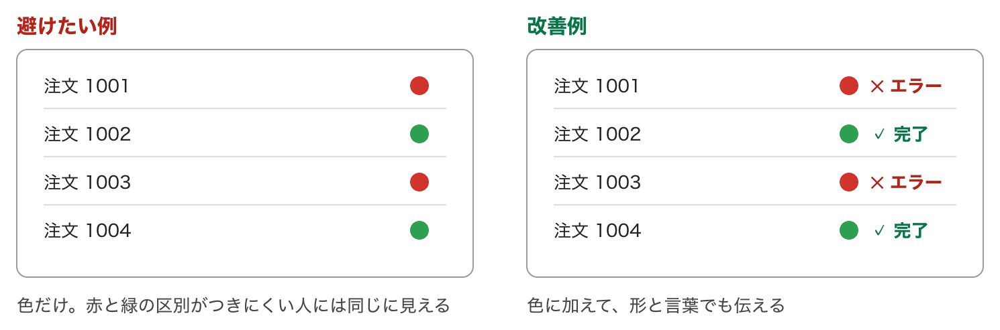
*色に加えて、形と言葉でも伝える*

**2. 文字と背景の差を付ける。** 薄いグレーの文字は、きれいに見えても読めません。WCAG は通常の文字でコントラスト比4.5対1以上を求めています。

**3. 文字を大きくしても崩れない。** ブラウザの文字サイズを大きくしても、はみ出したり重なったりしないように。

**4. キーボードだけで操作できる。** Tab キーで部品を順に移動し、Enter や Space で押せること。いまどこにいるか（フォーカス）が見えること。フォーカスの枠を「見た目が悪いから」と消してはいけません。

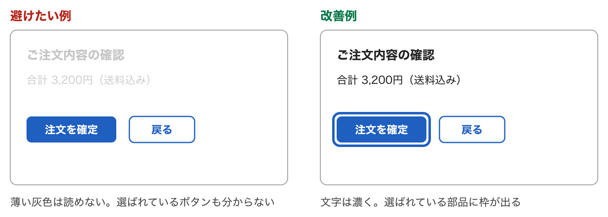
*文字は濃く。選ばれている部品に枠が出る*

**5. 画像とアイコンに言葉を付ける。** 画面を読み上げる道具は、画像やアイコンを見られません。代わりになる言葉（代替テキスト）が要ります。第2章の「アイコンには言葉を添える」と同じ話です。

やってみるなら、自分のアプリを、マウスを使わずに Tab キーだけで最初から最後まで操作してみてください。途中で先に進めなくなった場所、いまどこにいるか分からなくなった場所が、直すところです。

---

## 第7章　迷わせない ── 現在地を見せる、頭の中の絵に合わせる、最初は少なく、慣れたら近道

**ひとことで。** 利用者が「いまどこにいて、次に何をすればよいか」を、画面から読み取れるようにします。第2章までが一つの画面に閉じた話なら、この章は画面と画面のあいだ、つまり流れの話です。

**手順の何番目かを出す。** 申し込みや注文が複数の画面に分かれるなら、全体で何段階あり、いま何番目かを見せます。デジタル庁デザインシステムではステップナビゲーションという部品です。サイトの階層が深いなら、「ホーム › 注文 › お届け先」のような現在地の表示（パンくず）を付けます。

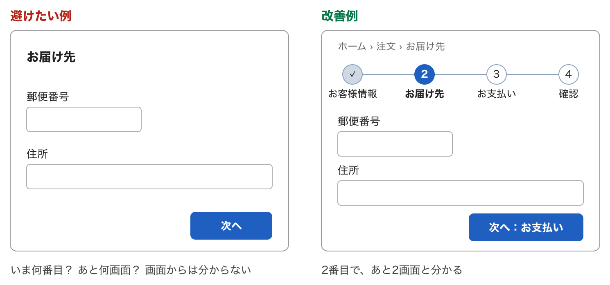
*2番目で、あと2画面と分かる*

**「戻る」ではなく行き先を書く。** 画面の中に「戻る」ボタンを作らないことを勧めます。一つの画面に来る道は一つとは限りません。一覧から来た人、検索結果から来た人、メールのリンクから来た人がいて、「戻る」がどこへ行くのかは人によって違います。来た道を戻るのは、ブラウザや OS の「戻る」の仕事です。それでもリンクが要るなら、「注文一覧へ」「設定へ」と行き先を書きます。英国政府のデザインシステムも、入口が多い複雑なサービスでは「Go back to [page]」のように行き先を書くよう勧めています。

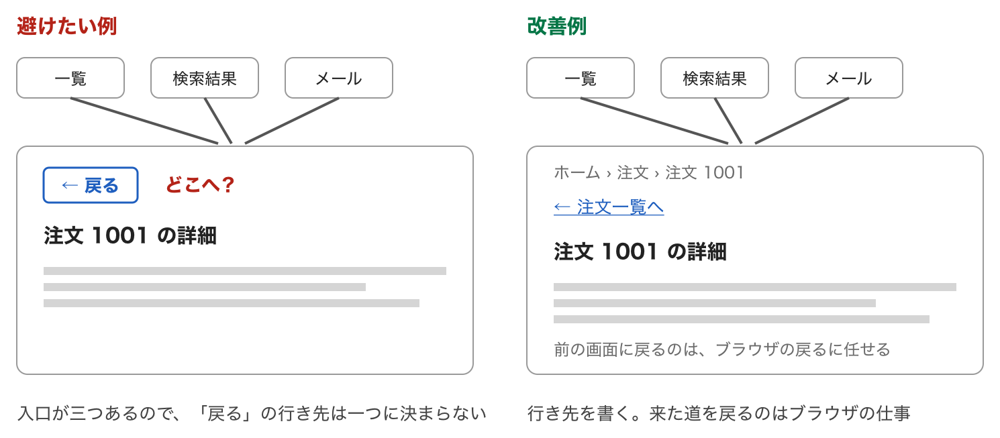
*行き先を書く。来た道を戻るのはブラウザの仕事*

**処理中は「待っている」と見せる。** NN/g は、1秒を超える待ちには処理中の表示を出すよう勧めています。数秒で終わるなら回転する印、10秒以上かかるなら進み具合が分かる棒にし、終わる見込みも示します。表示がないと、押し直しによる二重注文が起きます。

**空の画面も「状態」のうち。** 一覧に何もないとき、ただ白い画面を出すと、利用者は「壊れた？」「読み込み中？」と迷います。いまの状態と、次にできることを伝えます。

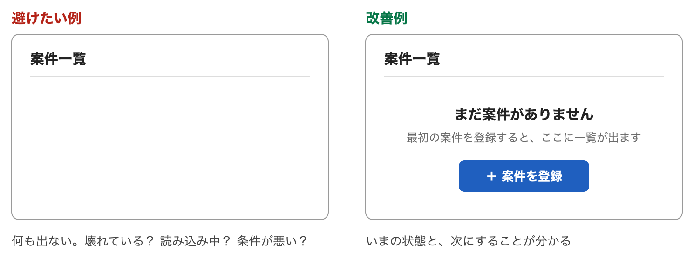
*いまの状態と、次にすることが分かる*

**対応づけ。** 操作する場所と、結果が出る場所の対応が見て分かること。ノーマンの有名な例がコンロです。四つのコンロが四角に並んでいるのに、つまみが一列に並んでいると、どのつまみがどのコンロか毎回迷います。画面でも同じで、右側の一覧を並べ替えるボタンが、左端の離れた場所にあると、対応づけが切れています。

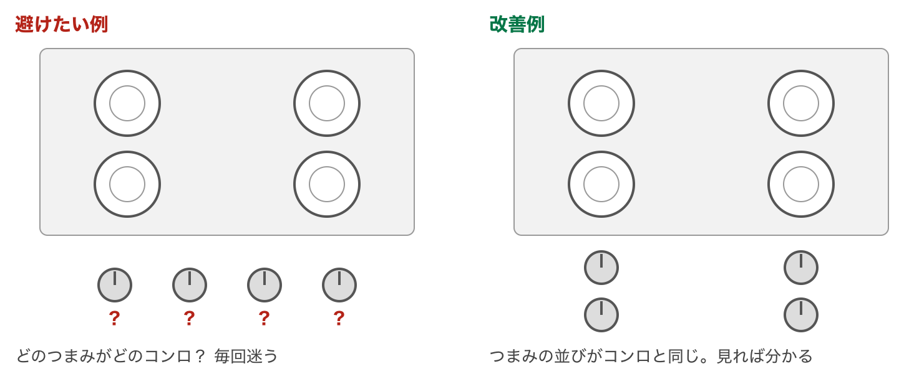
*つまみの並びがコンロと同じ。見れば分かる*

**モードを作らない。** 同じ操作の意味が、場面によって変わる状態をモードと言います。モードがあると、その場でできる操作が限られ、途中で考えを変えたときにまずモードから抜ける操作が要ります。「削除モード」に入ると行をタップするだけで消える、より、行ごとに「削除」を置くほうが安全です。

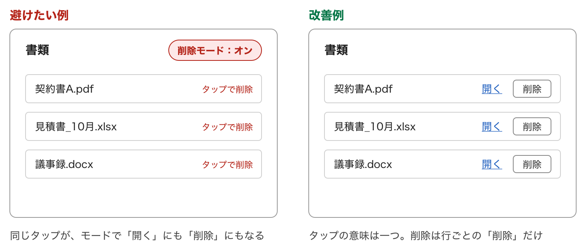
*タップの意味は一つ。削除は行ごとの「削除」だけ*

**最初は少なく、必要なら深く。** よく使う機能だけを最初に見せ、たまにしか使わない設定は「詳細設定」を開いたときだけ見せる（段階的開示）。そして初期値を入れておく。人は初期値をそのまま使います。NN/g は、検索結果の1位と2位をこっそり入れ替えても、やはり1位のほうがずっと多く押されたという実験を紹介しています。ただし、必ず読ませたい注意は折りたたみません。

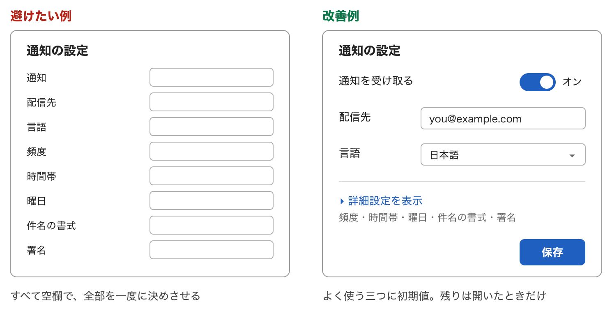
*よく使う三つに初期値。残りは開いたときだけ*

**初心者にも熟練者にも。** 初めての人には、順番どおりに進める手順が安心です。しかし毎日使う人にとって、同じ5画面を毎回たどるのは遅すぎます。「前回と同じ内容で注文」のような近道を用意します。助けは、画面の上に長い説明文を置くより、迷う欄のそばに一行のヒントを置くほうが読まれます。

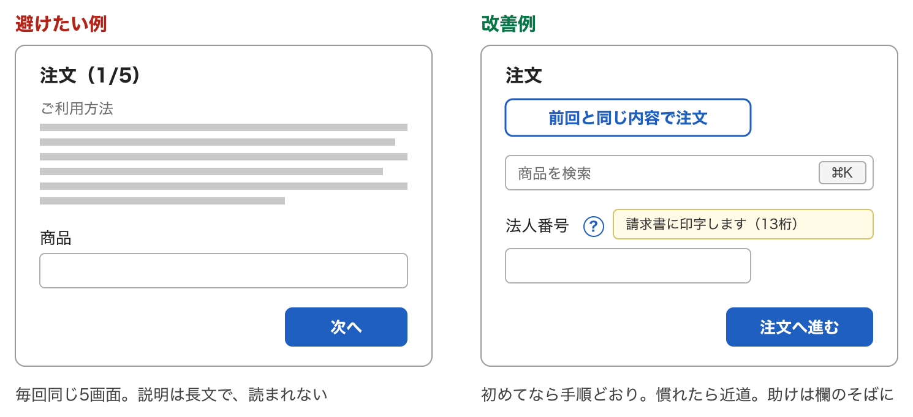
*初めてなら手順どおり。慣れたら近道。助けは欄のそばに*

---

## 第8章　操作させない・失わせない ── 聞かない、寛容に、自動保存、ログインと登録の癖

**ひとことで。** 利用者にさせる操作を、本当に必要な分だけにします。システムが分かることは聞きません。書き方の違いで突き返しません。書いたものは自動で守ります。そして、ログインや会員登録の画面で昔からの悪い癖を繰り返さないことです。

**聞かない。** Apple の指針が最初に挙げるのは、可能なときは常にシステムから情報を取る、という項目です。郵便番号を入れたら住所は決まります。生年月日を入れたら年齢は決まります。決まるものを、もう一度聞かないことです。同じ手続きの中で前に入れた情報をもう一度打たせないことは、WCAG 2.2 の達成基準「冗長な入力項目」にもなっています。

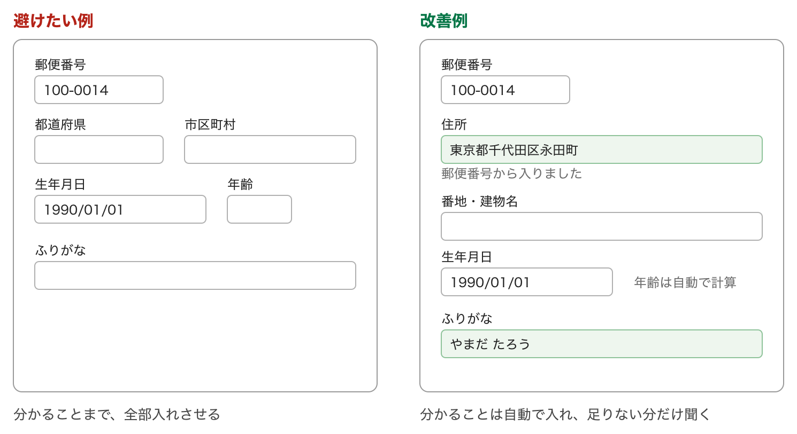
*分かることは自動で入れ、足りない分だけ聞く*

**寛容に受け付ける。** 電話番号のハイフン、カタカナの全角と半角。こうした書き方の違いで入力を突き返すのは、機械の都合を人に押しつけることです。デジタル庁デザインシステムは「原則として、入力できる文字種を限定しないようにします」と定めています。どうしても限定が要るときは、送信時に自動変換して確認画面で結果を見せます。

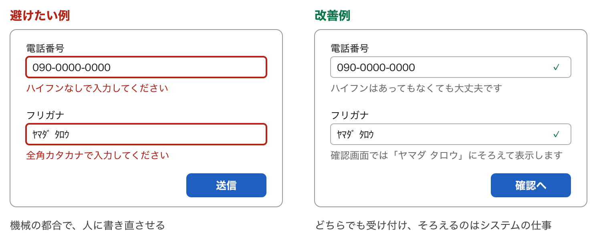
*どちらでも受け付け、そろえるのはシステムの仕事*

**失わせない。** 書いている途中で画面を閉じても、通信が切れても、戻ってきたら続きから書けるようにします。文書やメモの道具の多くは、保存ボタンを押さなくても書いた端から保存されます。自動保存にするなら、取り消しとセットにします。保存ボタンを残すなら、送信に失敗しても入力を消さない。大事なのは、自動保存か保存ボタンかをサービスの中で一つに決めることです。

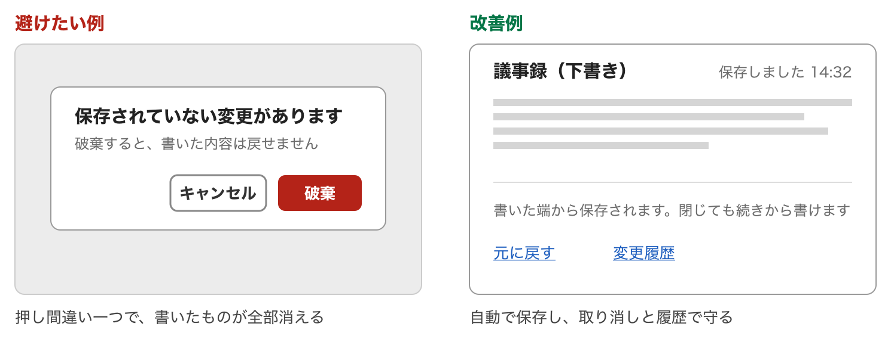
*自動で保存し、取り消しと履歴で守る*

**ログインと登録の悪い癖。** いまの基準は、米国国立標準技術研究所（NIST）のパスワード指針の最新版、Google の web.dev、英国政府のデザインシステムで、三つはほぼ同じことを言っています。

| 避けたい例 | 改善例 |
| --- | --- |
| パスワードが点のままで、見る手段がない | 「表示」「隠す」の切り替えを付ける |
| 「メールアドレス（確認のためもう一度）」 | 一回だけ聞き、入れた値を見せて直せるようにする |
| パスワード欄に貼り付けできない | 貼り付けとパスワードマネージャーを許す |
| 「8文字以上、大文字・数字・記号を含めてください」 | 長さの下限だけ決め、よくあるパスワードを拒否する |
| 90日ごとにパスワードの変更を求める | 求めない。漏えいの疑いがあるときだけ変更させる |
| 失敗時に、利用者名とパスワードのどちらが違うかを明かす | どちらが違うかは明かさない |

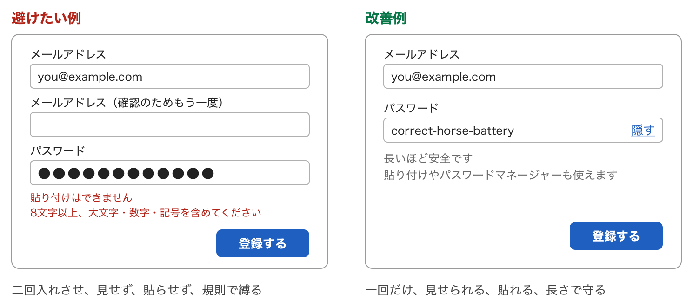
*一回だけ、見せられる、貼れる、長さで守る*

---

## 第9章　AI に画面を作らせるときの見方 ── 指示文とレビュー観点、チェックリスト

**ひとことで。** 第1章から第8章の原則を、AI への指示文と、できた画面を見るときの観点に変えます。守らせたい原則は、毎回のお願いではなく、毎回自動で効く場所に書きます。

AI が崩しやすいのは一貫性です。画面を一つずつ頼むと、画面ごとに言葉・色・配置が少しずつ変わります。一画面だけ見れば正しいのに、並べると崩れている。対策は二つで、ボタン・入力欄・見出しを一か所で定義して全画面でそれを使うよう指示すること、使う動詞の一覧を最初に決めて渡すことです。

「口頭の注意」は次の会話で忘れられます。プロジェクトの CLAUDE.md（AI が毎回読む指示書）に書いておきます。例です。

```markdown
## 画面のルール

- ボタンの言葉は動詞で、押した結果が分かるようにする（「OK」「はい」は使わない）
- 設定の項目名は肯定形「〜する」にそろえる。否定形と二重否定は使わない
- アイコンには必ず言葉を添える。アイコンだけのボタンには代替テキストを付ける
- エラー文は、その入力欄のすぐそばに、直し方つきで出す
- 確認ダイアログは、取り消せない操作にだけ出す
- 色だけで状態を区別しない。文字と背景のコントラスト比は 4.5 対 1 以上
- ボタン・入力欄・見出しは共通部品を使う。画面ごとに新しく作らない
- 一画面の主ボタンは一つ。保存は自動保存か保存ボタンかを一つに決め、保存ボタンなら常に右下
- 手続きが複数の画面に分かれるときは、何段階あり、いま何番目かを出す
- たまにしか使わない設定は「詳細設定」に折りたたみ、よく使う項目には初期値を入れる
- システムが分かること（郵便番号からの住所、生年月日からの年齢）は入力させない。同じ情報を二度聞かない
- 入力の形式や文字種の違いで突き返さない。そろえるのはシステム側で行う
- パスワード欄には表示の切り替えを付け、貼り付けとパスワードマネージャーを禁止しない。メールアドレスを二回入れさせない
- 画面の中に「戻る」ボタンを作らない（入口はあとから増える）。移動のリンクが要るなら「注文一覧へ」のように行き先を書く
```

できた画面は、コードを読む前に画面を開いて、次の順に見ます。3秒テスト、言葉、一貫性、操作の結果、配置、誰でも、流れ、入力。直すときは、画面を直させるのではなく「ルールを CLAUDE.md に足す」ことを先にします。同じ指摘を二度しているなら、それはルールにするべき合図です。

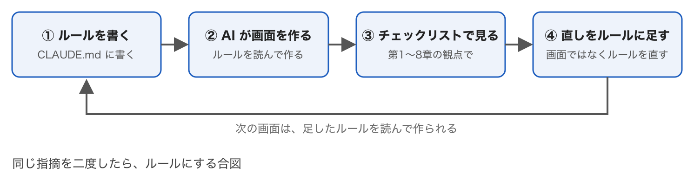
*同じ指摘を二度したら、ルールにする合図*

機械で判定できるものは、お願いより lint に任せるほうが確実です。アクセシビリティの基本は、React なら eslint-plugin-jsx-a11y、Vue なら eslint-plugin-vuejs-accessibility が指摘してくれます。できた画面は、ブラウザに入っている Lighthouse のアクセシビリティ診断で点数が出ます。

### チェックリスト

**言葉**

- [ ] ボタンの言葉は動詞で、押した結果が分かる
- [ ] 設定の項目名は肯定形「〜する」にそろっている
- [ ] 技術用語・内部の言葉が画面に出ていない
- [ ] 入力欄のラベルが欄の上にあり、入力例で代用していない

**見た目と配置**

- [ ] 同じ操作は、全画面で同じ言葉・色・位置になっている
- [ ] 押せるものは押せそうに見え、押せないものと区別できる
- [ ] アイコンには言葉が添えてある
- [ ] 一画面の主ボタンは一つ。危険な操作は離してある
- [ ] 「戻る」ボタンがない。移動のリンクは行き先の名前になっている

**操作**

- [ ] 押した直後に、画面のどこかが変わる
- [ ] 取り消せる。取り消せない操作にだけ確認が出る
- [ ] エラー文は欄のそばに、直し方つきで出る。入力は消えない
- [ ] 手順が複数の画面に分かれるなら、いま何番目かが見える
- [ ] よく使う項目に初期値が入り、たまにしか使わない設定は折りたたまれている
- [ ] システムが分かることや、前に聞いたことを、もう一度入力させていない
- [ ] 形式や文字種の違いで突き返さず、システム側でそろえている
- [ ] 書いている途中のものが消えない（自動保存か、入力を残す）
- [ ] パスワードは表示を切り替えられ、貼り付けできる。メールアドレスは一回だけ聞く

**誰でも**

- [ ] 色だけで状態を区別していない
- [ ] Tab キーだけで最後まで操作できる
- [ ] 画像とアイコンに代替テキストがある

---

## まとめ

一つだけ選ぶなら、**一貫性**です。AI がいちばん崩しやすく、利用者がいちばん早く気づくところだからです。

二つ目は、**ボタンの言葉を動詞にすること**。今日、自分の画面の「OK」を数えるところから始められます。

全体を通して言えるのは、これだけです。

> 原則は数十年前から変わっていない。変わったのは、画面を作る速さだけ。

速く作れるようになった分、見る側の物差しが要ります。この9章がその物差しになれば、と思います。全文は図と出典つきで公開してあります。

- [UI設計の基礎 ── 読まなくても分かる画面の作り方（Singularity Society「開発の心得」）](https://singularitysociety.github.io/societys_statement/development/ui_design/README.html)

---

## 出典

本文で引いた出典です。どれも記事を書いた時点で開けることを確認しています。

- ソシオメディア「[ヒューマンインターフェース ガイドライン](https://www.sociomedia.co.jp/category/shig)」 ── 一貫性、シグニファイア、ユーザーの言葉を使う、ユーザーの記憶に頼らない、メンタルモデル、マッピング、モードレス ほか
- NN/g「[10 Usability Heuristics for User Interface Design](https://www.nngroup.com/articles/ten-usability-heuristics/)」 ── 10原則の本体
- NN/g の個別記事 ── [Icon Usability](https://www.nngroup.com/articles/icon-usability/)、[Confirmation Dialogs](https://www.nngroup.com/articles/confirmation-dialog/)、[Error-Message Guidelines](https://www.nngroup.com/articles/error-message-guidelines/)、[Progress Indicators](https://www.nngroup.com/articles/progress-indicators/)
- NN/g の個別記事（続き） ── [The Power of Defaults](https://www.nngroup.com/articles/the-power-of-defaults/)、[Mental Models](https://www.nngroup.com/articles/mental-models/)、[Preventing User Errors: Avoiding Unconscious Slips](https://www.nngroup.com/articles/slips/)、[Stop Password Masking](https://www.nngroup.com/articles/stop-password-masking/)
- [デジタル庁デザインシステム](https://design.digital.go.jp/) ── ボタン、スイッチ、チェックボックス、インプットテキスト、ステップナビゲーション、パンくずナビゲーション、ディスクロージャー
- WAIC「[WCAG 2.1（日本語訳）](https://waic.jp/translations/WCAG21/)」「[WCAG 2.2（日本語訳）](https://waic.jp/translations/WCAG22/)」
- NIST「[SP 800-63B 第4版](https://pages.nist.gov/800-63-4/sp800-63b.html)」、web.dev「[ログイン フォームのベスト プラクティス](https://web.dev/articles/sign-in-form-best-practices?hl=ja)」、GOV.UK Design System「[Passwords](https://design-system.service.gov.uk/patterns/passwords/)」「[Back link](https://design-system.service.gov.uk/components/back-link/)」
- Apple「[Human Interface Guidelines](https://developer.apple.com/jp/design/human-interface-guidelines/)」 ── データの入力、取り消し/やり直し
- D. A. ノーマン『[誰のためのデザイン？ 増補・改訂版](https://www.shin-yo-sha.co.jp/book/b455574.html)』新曜社、2015年
- Jenifer Tidwell『[デザイニング・インターフェース 第2版](https://www.oreilly.co.jp/books/9784873115313/)』オライリー・ジャパン、2011年

---

## 関連記事

- [AIに大きな仕様書を渡して一気に作らせるのは、宝くじを買うようなものです](https://zenn.dev/singularity/articles/small-teams-ai) ── 作る前に、どこまで決めておくのか
- [1日500コミットは、もう読めない ── だからコードレビューをやめた](https://zenn.dev/singularity/articles/stopped-reviewing-my-code) ── 規約を機械に守らせる話。この記事の CLAUDE.md はその画面版です
